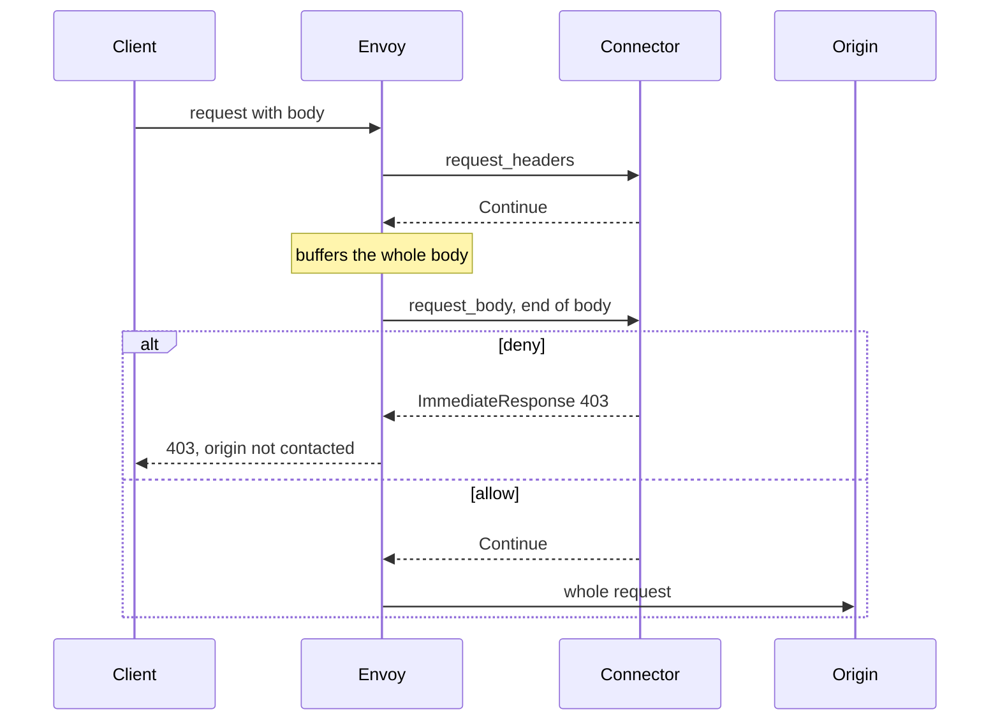
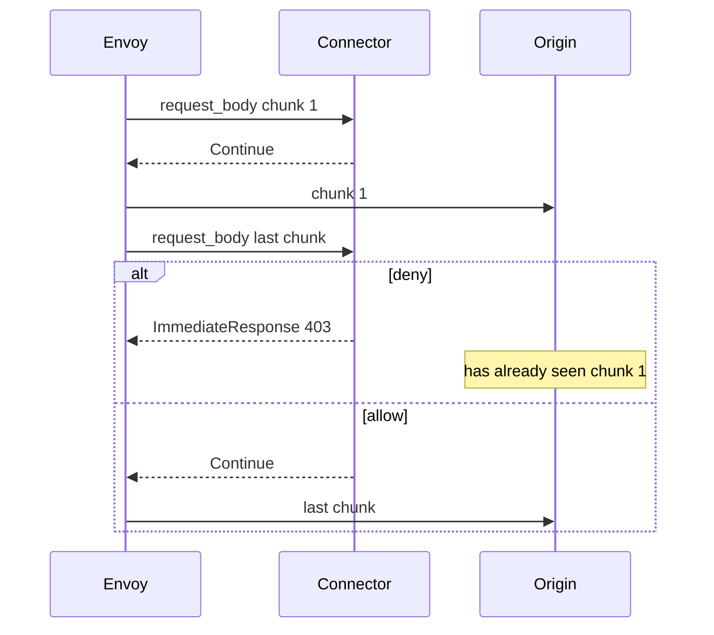
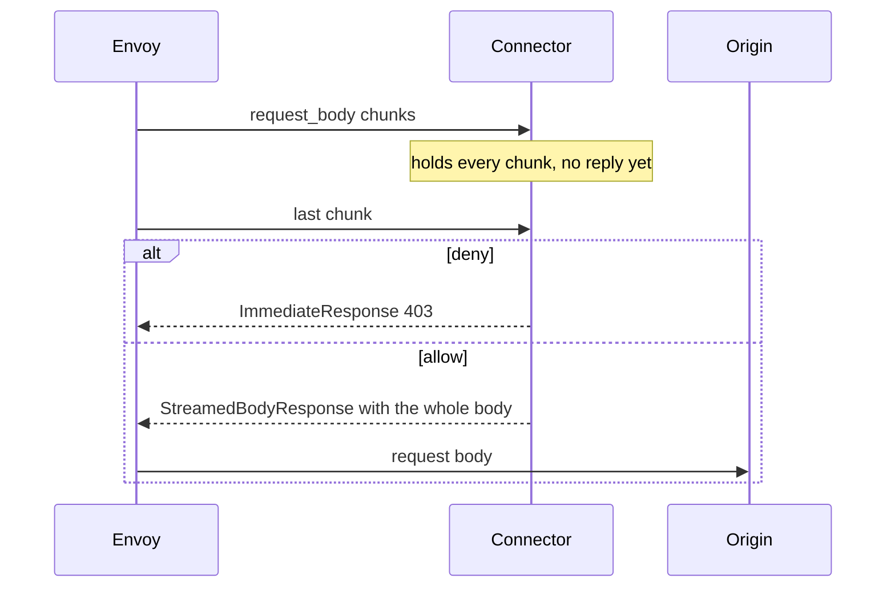

# Body modes

Envoy's `ext_proc` filter has a body mode (`BodySendMode`) per direction. It decides whether the connector sees request and response bodies, and when Envoy lets body bytes move on. The connector does the same thing in every mode: it appends each chunk to the ModSecurity transaction, checks for an intervention on every append, and runs the body phase when the body ends ([below](#where-the-body-phase-ends)). Wiring for each mode: [deploy.md](./deploy.md#5-pick-a-body-mode).

| ModSecurity phase | Envoy message | Connector |
|-------------------|---------------|-----------|
| 1, request headers | `request_headers` | reads the body modes from `protocol_config`; opens the transaction; connection, URI, headers. If the request has no body, or the request body mode is NONE, also phase 2 |
| 2, request body | `request_body` | appends; `process_request_body` when the body ends |
| 3, response headers | `response_headers` | response headers. If phase 2 has not run yet: **500** for a status below 400; for a 4xx/5xx, phase 2 runs late |
| 4, response body | `response_body` | appends; `process_response_body` when the body ends |
| 5, logging | stream end | audit log; frees the transaction |

OWASP CRS scores most attacks in phases 1 and 2 and blocks on the total in phase 2 (rule 949110), so in practice a request is judged when its body ends.

## Where the body phase ends

The connector takes each direction's body mode from the `protocol_config` Envoy sends with the first message of every stream. A stream without it, with `GRPC`, or with a mode that disagrees with `--body-reply` fails closed with **500**. The body phase then ends:

| Body mode | Body phase ends at |
|-----------|--------------------|
| BUFFERED, BUFFERED_PARTIAL | the one body message, whether or not it is marked end of stream (Envoy leaves the mark off when trailers follow) |
| NONE | the headers |
| STREAMED, FULL_DUPLEX_STREAMED | the chunk marked end of stream, or the trailers |

So with any body mode but NONE, Envoy's trailer modes must be `SEND`. With `SKIP`, Envoy never tells the connector that a STREAMED or FULL_DUPLEX body which trailers follow has ended, and a request with trailers but no body sends no body message at all. Envoy then forwards that request to origin: `SKIP` is not fail-closed. Every shipped config with a body mode sets both trailer modes to `SEND`. Trailer *values* are never passed to ModSecurity. `demo/scripts/h2-trailers.sh` checks HTTP/2 bodies and queries that end in trailers.

A message on a phase that already ended, or Envoy closing the stream while a body phase is still open, also fails closed.

## Comparison

| Mode | Request-body deny happens | Response-body rules | Hung connector | Demo | Tested |
|------|---------------------------|---------------------|----------------|------|--------|
| **BUFFERED** (default) | before the origin sees any of the body | before the client sees the body | **504** | `BODY_MODE=BUFFERED` | every PR, monthly full CRS |
| **STREAMED** | after early chunks may have reached the origin | after the response headers, and possibly body chunks, reached the client; a deny resets the stream | **504** | `BODY_MODE=STREAMED` | every PR, monthly full CRS |
| **FULL_DUPLEX_STREAMED** | before the origin sees any of the body | before the client sees the body | not bounded by `message_timeout` ([below](#full_duplex_streamed)) | `BODY_MODE=FULL_DUPLEX_STREAMED` | every PR, monthly full CRS |
| **NONE** | never: bodies are not sent | never | **504** | `BODY_MODE=NONE` | weekly, headers only |
| **BUFFERED_PARTIAL** | before the origin, on the prefix up to the buffer limit; bytes past it are not inspected | on the prefix only | **504** | `BODY_MODE=BUFFERED_PARTIAL` | weekly, under the limit only |
| **GRPC** | not implemented in the pinned Envoy | — | — | — | — |

Request and response can use different modes; the demo has `REQ_BUFFERED_RESP_STREAMED` and `REQ_STREAMED_RESP_BUFFERED`, tested weekly.

## BUFFERED

Envoy holds the whole request body, then sends it in one message that ends the body. A body deny lands before the origin sees anything, including an attack that sits only in the last HTTP/1.1 chunk or HTTP/2 DATA frame. The response works the same way, so the response-body rules decide before the client sees the body.

Bodies larger than Envoy's buffer limit (`per_connection_buffer_limit_bytes`, default 1 MiB) are rejected by Envoy with **413**. Inside the limit, ModSecurity's own limits from `engine.conf` apply. Do not use BUFFERED on WebSocket upgrade routes: the upgrade waits for a body end that never comes ([envoy#47081](https://github.com/envoyproxy/envoy/issues/47081)).

Demo config: [`demo/envoy/envoy.yaml`](../demo/envoy/envoy.yaml).

## STREAMED

Envoy sends each chunk as it arrives and lets it move on after the connector's Continue. The connector still appends every chunk and runs the body phase at the end, so:

- **Requests:** early chunks can reach the origin before the phase-2 deny at the end of the body. Only an intervention raised while appending (for example a body-limit reject) stops the body mid-stream.
- **Responses:** Envoy forwards the response headers as soon as the connector answers them, and then each chunk after its Continue. Phase 4 runs at the end of the response, so a response-body deny comes after the client already has the status line and possibly some of the body. Envoy cannot turn that into a 403; it resets the client stream instead, and bytes already sent are not recalled. Treat response-body rules as detection under STREAMED; use BUFFERED or FULL_DUPLEX_STREAMED for the response to block with 403. (The demo origin writes headers and body in one segment, so its response-body cells still see 403.)

Open Envoy issues: [envoy#47449](https://github.com/envoyproxy/envoy/issues/47449) (two ext_proc filters with trailers), [envoy#47048](https://github.com/envoyproxy/envoy/issues/47048) (STREAMED with WebSocket, reported on v1.39.1, not re-measured at the pin).

Demo config: [`demo/envoy/envoy-streamed.yaml`](../demo/envoy/envoy-streamed.yaml).

## FULL_DUPLEX_STREAMED

Envoy streams in both directions and expects every body reply to be a `StreamedBodyResponse`, so the connector must run with `--body-reply streamed`, and the trailer modes must be `SEND`. The connector does not answer any chunk until ModSecurity has allowed the whole body, then releases it in one reply. A body deny therefore keeps the origin untouched, as in BUFFERED.

Costs:

- The connector holds each body in memory until ModSecurity allows it, up to `--max-held-body-bytes` per direction (default 4 MiB, the gRPC message limit). A larger body fails closed with **500** and nothing is released.
- Envoy does not apply `message_timeout` in this mode. The connector answers **504** when Envoy goes silent for `--duplex-idle-timeout` (30 s) while a body is held, or the stream runs past `--duplex-total-timeout` (300 s) without a verdict. A hung connector cannot fire those, so it is bounded only by other Envoy timeouts ([deploy.md](./deploy.md#full_duplex_streamed-timeouts)); the hang → 504 drill does not apply.
- Envoy may fold client trailers into the end of the body, so the connector may never see a separate trailers message.
- Open Envoy issues: duplicate end of stream [envoy#46237](https://github.com/envoyproxy/envoy/issues/46237), upgrade hang [envoy#47161](https://github.com/envoyproxy/envoy/issues/47161), memory use [envoy#39514](https://github.com/envoyproxy/envoy/issues/39514).

Demo config: [`demo/envoy/envoy-full-duplex.yaml`](../demo/envoy/envoy-full-duplex.yaml).

## NONE

Envoy's default. Only headers go to the connector; bodies go straight to the origin and the client.

- The connector runs phases 1 and 2 at the request headers, with an empty body, for every request. URL and header attacks are blocked before the origin, with or without a request body.
- Request and response bodies are never inspected: body attacks reach the origin, and response-body rules see nothing.

The demo also uses NONE for its gRPC and WebSocket handshake traces. Demo config: [`demo/envoy/envoy-none.yaml`](../demo/envoy/envoy-none.yaml).

## BUFFERED_PARTIAL

Envoy buffers up to its buffer limit and then sends what it has, in one body message. Under the limit this behaves like BUFFERED. Over the limit, that message is the prefix; the connector ends the body phase there, so the prefix is judged before the origin, and bytes past the limit are never inspected. With the demo's 1 MiB limit, bodies just over 1 MiB were still delivered whole on Envoy v1.39.1, and around 2 MiB or more were not; this has not been re-measured at the pin. This mode is never a full CRS claim. `demo/scripts/partial-honesty.sh` shows a SQLi in a small body blocked, and a SQLi after a 2 MiB pad reaching the origin.

Demo config: [`demo/envoy/envoy-buffered-partial.yaml`](../demo/envoy/envoy-buffered-partial.yaml).

## GRPC

`BodySendMode.GRPC` is marked not implemented in the pinned Envoy's API. There is no demo config, test or CRS claim for it. It is unrelated to gRPC traffic: gRPC requests can pass through any mode, and their protobuf bodies are not CRS-inspected.
