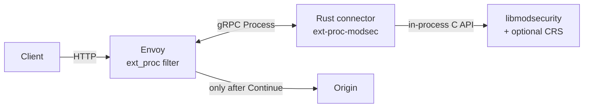

# How it works

What the product is, where it sits, how an HTTP request moves through it, and what you see when something is blocked or the WAF cannot decide.

Pins: [`versions.lock.md`](../versions.lock.md). Failure model: [fail-closed.md](./fail-closed.md). Tests: [testing.md](./testing.md). Local PoC (build → exercise → tear down): [Getting started](./modes/getting-started.md). Deeper demo notes: [`demo/README.md`](../demo/README.md). Security scan: [ash.md](./ash.md).

---

## What this is

**modsec-envoy-connector** protects HTTP workloads that sit behind [Envoy Proxy](https://www.envoyproxy.io/) with **ModSecurity** and (optionally) the **OWASP Core Rule Set (CRS)**.

Envoy cannot run ModSecurity itself. This project is a small Rust gRPC server (`ext-proc-modsec`) that Envoy's **External Processing** (`ext_proc`) filter calls for every HTTP exchange. The connector loads libmodsecurity in-process, calls its C API (`msc_*` in `modsec-engine`), feeds request headers, request body, response headers, and response body into **one libmodsecurity transaction**, and answers each step with:

- **Continue**: Envoy may proceed (and only then may contact the origin on the request path),
- a rule-driven **local reply** (typically **403**, or a redirect), or
- a fail-closed **500** when the engine cannot produce a trustworthy decision.

The connector never dials your origin. Only Envoy does, and only after Continue.

---

## Where it sits

Three network hops, plus one in-process call:

| Hop | From → To | Protocol | Reaches origin? |
|-----|-----------|----------|-----------------|
| 1 | Client → **Envoy** | HTTP/1.1, HTTP/2 | No |
| 2 | **Envoy ↔ connector** | gRPC bidi `envoy.service.ext_proc.v3.ExternalProcessor/Process` | No (side-call) |
| - | connector → **libmodsecurity** | in-process C API (`msc_*` in `modsec-engine`) | No |
| 3 | **Envoy → origin** | HTTP | **Yes (Envoy only)**, after Continue |

Demo ports (local): Envoy `:18080`, connector `:18081`, metrics/healthz `:18082`, origin `:18098`.



Enforcement settings that must not be relaxed on a protecting filter:

- `failure_mode_allow: false`: connector down or stream error → Envoy local **500**
- `message_timeout: 2s`: connector hung → Envoy local **504**
- Never enable `observability_mode` for enforcement: Envoy does not wait for answers there

---

## Request path

One `Process` stream = one HTTP request/response = **one ModSecurity transaction**.

```mermaid
sequenceDiagram
  participant C as Client
  participant E as Envoy
  participant R as Rust connector
  participant M as libmodsecurity
  participant U as Origin

  C->>E: HTTP request
  Note over E: ext_proc before router<br/>failure_mode_allow: false<br/>message_timeout: 2s

  E->>R: request_headers
  R->>M: process_connection / process_uri / process_request_headers
  alt Phase-1 deny / redirect
    R-->>E: ImmediateResponse (e.g. 403)
    E-->>C: local reply (origin never contacted)
  else Engine / protocol error
    R-->>E: ImmediateResponse 500
    E-->>C: local 500
  else Allow
    R-->>E: Continue
  end

  E->>R: request_body (BUFFERED whole entity, STREAMED chunks, or BUFFERED_PARTIAL prefix)
  R->>M: append_request_body (every chunk)<br/>process_request_body at end_of_stream
  Note over E,R: BUFFERED_PARTIAL sends at most per_connection_buffer_limit_bytes<br/>(demo: 1 MiB). Trailing attacks past that prefix can miss; not full CRS.
  alt Phase-2 deny / body-limit / fail-closed
    R-->>E: ImmediateResponse 403 or 500
    E-->>C: local reply
  else Allow
    R-->>E: Continue
    E->>U: forward request
    U-->>E: response
  end

  E->>R: response_headers / response_body
  R->>M: process_response_headers / append + process_response_body
  alt Phase-3/4 deny
    R-->>E: ImmediateResponse 403
    E-->>C: local 403
  else Allow
    R-->>E: Continue
    E-->>C: origin response
  end
```

HTTP/1.1 and HTTP/2 (cleartext prior knowledge in the demo) use the same connector path. Envoy reassembles split HTTP/2 `Cookie` headers before the connector sees them. The demo enables `allow_custom_methods` so CRS rule 911100 enforces method policy instead of the codec dropping non-standard methods.

`demo/scripts/hop-trace.sh` walks one request across Envoy, the connector, and the origin by `x-request-id`.

---

## Body modes that change the path

The connector code path is the same for BUFFERED / STREAMED / BUFFERED_PARTIAL: **append every chunk, check intervention on every append, run `process_*_body` when the body phase ends**. Each direction's body mode comes from `protocol_config` on Envoy's first message of the stream; a stream without it, with `GRPC`, or with modes that disagree with `--body-reply` fails closed (**500**). The body phase ends at the one body message for BUFFERED / BUFFERED_PARTIAL (Envoy sends it with `end_of_stream=false` when trailers follow), at the headers for NONE, and at `end_of_stream` or the trailers for STREAMED / FULL_DUPLEX_STREAMED. That is why every shipped config with a body mode sets trailer modes `SEND`: without trailers, response headers that arrive before the request body phase ran answer **500**. What changes is when Envoy is willing to forward bytes toward the origin, and for `FULL_DUPLEX_STREAMED`, the Continue wire shape.

| Mode | Envoy behaviour | Origin exposure on request deny | Demo / CI |
|------|-----------------|----------------------------------|-----------|
| **BUFFERED** (default) | Holds the full request (and response) entity until the connector has inspected it | A request-body deny happens **before** the origin sees anything, including when the attack sits only in the last chunk or last HTTP/2 DATA frames | `demo/envoy/envoy.yaml`; full CRS / go-ftw; `crs-full` × BUFFERED |
| **STREAMED** | Delivers body chunks as they arrive | Non-disruptive Continues may let early chunks move toward the origin before phase-2/4 decides at EOS; body-limit rejects can still fire mid-stream on append. Responses: Envoy forwards the response headers once the connector answers them, so a phase-4 deny for a body that arrives later resets the stream instead of answering 403, and the client may already hold the status and the chunks before it (the demo origin writes headers and body in one segment, so its leak cells see 403) | `demo/envoy/envoy-streamed.yaml`, `BODY_MODE=STREAMED`; hosted `e2e-streamed` ≡ `e2e-pin` product suites; `crs-full` matrix **wired** for STREAMED (hosted green not yet shown on tip) |
| **BUFFERED_PARTIAL** | One body message up to the buffer limit (prefix only if over) | Small bodies behave like BUFFERED; over-limit trailing attacks can miss (ProcessPartial class); **not** a CRS claim | `demo/envoy/envoy-buffered-partial.yaml`, `BODY_MODE=BUFFERED_PARTIAL`; weekly `e2e-lab` `e2e-buffered-partial` (under-limit only) |
| **NONE** | No request/response bodies to ext_proc | Body CRS n/a; query/header CRS can still fire; body attacks must reach origin | `demo/envoy/envoy-none.yaml`, `BODY_MODE=NONE`; weekly `e2e-lab` `e2e-none` (headers smoke + fail-closed); also gRPC/WS demos |
| **FULL_DUPLEX_STREAMED** | Duplex streamed body; trailer mode must be `SEND`; `message_timeout` **off**, so the connector's `--duplex-idle-timeout` (body held, no message) and `--duplex-total-timeout` answer **504** | Connector holds chunks (Silent) and only emits one `StreamedBodyResponse` **after** ModSec allows, so request-body deny still keeps origin untouched. The held body is capped per direction by `--max-held-body-bytes` (default = `--max-grpc-message-bytes`, 4 MiB); past the cap the exchange fails closed with **500** | `demo/envoy/envoy-full-duplex.yaml`, `BODY_MODE=FULL_DUPLEX_STREAMED` (auto `--body-reply streamed`); CI `e2e-full-duplex` ≡ product suites; `crs-full` matrix **wired** for FULL_DUPLEX (hosted green not yet shown on tip) |

**Out of scope on pinned Envoy v1.39.4:** `BodySendMode.GRPC` (enum 5) is marked `[#not-implemented-hide:]` in the committed proto (generated from the v1.39.1 API closure). No connector YAML, CI cell, or CRS claim.

Default connector Continue for body messages is an empty `BodyResponse` (`--body-reply common`). Envoy rejects that shape under `FULL_DUPLEX_STREAMED` (`spurious_message: Normal_body_mutation…`); `--body-reply streamed` switches Continues to `BodyMutation.streamed_response`. It must be `streamed` exactly when a direction in `protocol_config` is FULL_DUPLEX_STREAMED, or the stream fails closed. Fail-closed / deny still use `ImmediateResponse` and are unchanged.


```mermaid
flowchart TB
  subgraph buffered [BUFFERED - default / full CRS]
    B1[Envoy buffers full request body] --> B2[Connector append + process_request_body]
    B2 -->|deny / fail-closed| B3[Local 403 / 500 (origin untouched)]
    B2 -->|Continue| B4[Envoy forwards to origin]
  end

  subgraph streamed [STREAMED]
    S1[Envoy sends body chunks as they arrive] --> S2[Connector append + intervention per chunk]
    S2 -->|disruptive on append| S3[Local 403 / 500]
    S2 -->|Continue chunk| S4[Chunk may proceed toward origin]
    S2 -->|end_of_stream| S5[process_request_body (phase 2)]
    S5 -->|deny| S3
    S5 -->|Continue| S6[Request settled]
  end
```

Envoy's buffer limit (default 1 MiB per stream) caps BUFFERED inspectable body size; STREAMED moves buffering into the connector/engine. The monthly `crs-full` workflow runs BUFFERED, STREAMED, and FULL_DUPLEX in a matrix (see [docs/modes/](./modes/)). BUFFERED hosted go-ftw-full is proven green; STREAMED / FULL_DUPLEX cells are **wired**, not yet proven green on tip. Phase-2/4 CRS rules still decide at EOS after reassembly.

---

## One exchange, step by step

| Envoy sends | Connector does | Answers |
|-------------|----------------|---------|
| `request_headers` | Reads `protocol_config` (first message only) and opens the transaction (id generated by the connector; `x-request-id` is logged next to it). Runs `process_connection` (client/server IP:port from Envoy attributes), `process_uri`, adds non-pseudo headers (`host` from `:authority` if missing), `process_request_headers`. If `end_of_stream` or the request body mode is NONE, also runs the request-body phase. | Continue, or terminal reply |
| `request_body` | `append_request_body` (intervention checked on every append); when the body phase ends (see body modes) runs `process_request_body` (CRS phase 2). | Continue, or terminal reply |
| `response_headers` | If the request body phase has not run, fails closed (**500**) for a status below 400, and inspects the request body late for 4xx/5xx. Adds headers, `process_response_headers` (phase 3). If `end_of_stream` or the response body mode is NONE, also runs the response-body phase. | Continue, or terminal reply |
| `response_body` | `append_response_body`; when the body phase ends runs `process_response_body` (phase 4). | Continue, or terminal reply |
| trailers | Trailer *values* are not CRS-inspected (no SecLang trailer phase). Trailers end a STREAMED / FULL_DUPLEX body phase that is still open (BUFFERED bodies already ended at their one message), then Continue. Without a session → fail-closed **500**. | Continue, body deny **403**, or **500** |
| `response_headers` with **no** prior `request_headers` | Envoy rejected the request itself before the request phase (e.g. `#fragment` → 400) and ext_proc only sees that local reply. Origin was never contacted. 4xx/5xx pass through; anything else fails closed. | Continue (4xx/5xx), else **500** |

Stream end drops the session, which runs ModSecurity's logging phase (audit log) and frees the transaction. That drop runs on Tokio's blocking pool, after any terminal reply has been handed to tonic, so audit-log I/O neither stalls an async worker nor delays a **403**. Out-of-order or malformed messages fail closed with **500**.

The stream only ends with gRPC **OK** after a terminal `ImmediateResponse`, or when Envoy closes its side with every message answered. Envoy v1.39 treats an OK close as "processing complete" and forwards whatever it holds, so every other end is a non-OK gRPC status, which `failure_mode_allow: false` turns into a local **500**: a message the connector cannot read (including one larger than `--max-grpc-message-bytes`), Envoy closing while a FULL_DUPLEX body is still held or a body phase is still open, a ModSecurity drop (`ABORTED`), or a connector panic (h2 stream reset).

---

## Fail-closed (path-level)

**Deny ≠ fail.** A rule deny (**403**) means the WAF decided. **500** / **504** means it could not decide, and traffic must not reach the origin as OK.

| Case | Who enforces | Client |
|------|--------------|--------|
| Connector not running / crashed / stream error | Envoy (`failure_mode_allow: false`) | **500** |
| Message larger than `--max-grpc-message-bytes`, or otherwise unreadable | Connector ends the stream with gRPC `INTERNAL`; Envoy (`failure_mode_allow: false`) | **500** |
| FULL_DUPLEX body above `--max-held-body-bytes` | Connector `ImmediateResponse` 500 (`modsec_fail_closed`) | **500** |
| Connector hung past `message_timeout` (2s) | Envoy | **504** |
| No message from Envoy for `--stream-idle-timeout` before the verdict; FULL_DUPLEX past `--duplex-idle-timeout` / `--duplex-total-timeout` | Connector `ImmediateResponse` 504 (`modsec_stream_timeout`) | **504** |
| Rules fail to load at boot, or the rules files define 0 rules | Connector exits non-zero before binding; Envoy then returns 500 | **500** |
| Per-request engine error / phase-order / malformed message / missing or unsupported `protocol_config` / response before the request body phase ran | Connector `ImmediateResponse` 500 (`modsec_fail_closed`) | **500** |
| Rule deny | Connector `ImmediateResponse` (rule status, validated) | typically **403** |

There is **no** code path that answers Continue after an engine error. Body mode (BUFFERED / STREAMED) does not relax fail-closed. Details and drills: [fail-closed.md](./fail-closed.md).

---

## What is not inspected

These limits are intentional and covered by demo suites. They are not temporary gaps.

| Surface | What happens | Bound |
|---------|--------------|-------|
| **gRPC protobuf bodies** | Headers / path / metadata hop-trace works (`hop-trace-grpc.sh`, `envoy-grpc.yaml` with body `NONE`). Fail-closed holds. | **Not** protobuf CRS / streaming RPC WAF. Stock CRS may still deny HTTP-shaped paths on the gRPC codec; that is not "gRPC body CRS." |
| **WebSocket frames** | Handshake can be ModSec-inspected with headers-only + upgrade config. Post-upgrade frames are opaque (SQLi-shaped frames echo). | **Not** frame CRS. BUFFERED+upgrade can hang; fail-closed still applies on the handshake path. |
| **HTTP/3** | No QUIC listener in the product demo. | Not supported. |
| **Trailer values** | No SecLang trailer phase. | Not CRS-inspected; shipped configs with a body mode send them (`SEND`) only so the body phase can end. |
| **Envoy local replies before request phase** | Connector only sees the local reply stream. | Not ModSec-inspected; 4xx/5xx pass through. |
| **Pause interventions** | Logged and ignored. | ext_proc has no delay primitive. |
| **Drop → TCP reset** | Maps to gRPC stream abort → Envoy **500**. | ImmediateResponse cannot close the TCP connection. |

---

## What you see when blocked

| Engine / path result | Connector answer | Client sees | Ops signal |
|----------------------|------------------|-------------|------------|
| No disruptive intervention | Continue | Origin response | phase log `action=allow` |
| Deny with status 4xx/5xx | `ImmediateResponse` with that status, generic body | e.g. **403** `Forbidden` | Envoy `%RESPONSE_CODE_DETAILS%` = `modsecurity_intervention`; connector log + ModSecurity audit log hold rule detail |
| Deny with any other status (1–399, ≥ 600, or unknown to Envoy) | `ImmediateResponse` **403** | **403** | same: statuses are validated because Envoy v1.39 would otherwise send an invalid ImmediateResponse as **HTTP 200** |
| Redirect | `ImmediateResponse` 3xx (302 if the rule's status is not 3xx) + `Location` | **302** | `action=redirect` |
| Drop (intervention status 0) | Stream aborted with gRPC `ABORTED` | Envoy local **500** | deny metric; not status 0 |
| Engine / protocol failure | `ImmediateResponse` **500**, details `modsec_fail_closed` | **500** | `action=fail_closed` |
| `CONNECT` | `ImmediateResponse` **403**, details `connect_rejected` | **403** | CONNECT never reaches a BUFFERED body hang |
| Connector down | *(no answer)* | Envoy **500** | `ext_proc_error_*`; `failure_mode_allowed` must stay **0** |
| Connector hung | *(no answer in time)* | Envoy **504** | `message_timeouts` |

The deny body is always generic (`Forbidden`). Rule ids and matched data go only to the connector log and the ModSecurity audit log, never to the client. After any terminal answer the connector closes the stream.

---

## Code map

| Crate / file | Role |
|--------------|------|
| `crates/modsec-engine/` | The only crate with `unsafe`. Declares the libmodsecurity v3 `msc_*` API; `Engine` loads rules at boot; `InspectionSession` is one transaction and maps interventions to `Decision`. |
| `crates/ext-proc-modsec/src/processor.rs` | `ModSecProcessor` (tonic). One `Exchange` per gRPC stream; turns each `ProcessingRequest` into Continue / terminal reply / abort. |
| `crates/ext-proc-modsec/src/responses.rs` | Builds Continue / `ImmediateResponse`; validates statuses. |
| `crates/ext-proc-modsec/src/connection_meta.rs` | Reads Envoy `request_attributes` for `process_connection` / URI protocol. |
| `crates/ext-proc-modsec/src/metrics.rs`, `metrics_server.rs` | Prometheus counters/histograms; `GET /metrics`, `GET /healthz`. |
| `crates/ext-proc-modsec/src/pb/` | Committed prost/tonic for `envoy.service.ext_proc.v3` (generated from the Envoy v1.39.1 API closure; runtime pin is v1.39.4). |

---

## Configuration

Connector flags (each also readable from the environment):

| Flag | Env | Default | Notes |
|------|-----|---------|-------|
| `--listen` | `EXT_PROC_LISTEN` | `127.0.0.1:18081` | gRPC address Envoy's `modsec_ext_proc` cluster targets (HTTP/2). |
| `--metrics-listen` | `EXT_PROC_METRICS_LISTEN` | `127.0.0.1:18082` | `/metrics` and `/healthz`. |
| `--modsec-rules` | `MODSEC_RULES` | *(required)* | One or more files, loaded in order (engine directives → `crs-setup.conf` → `rules/*.conf`). Startup fails if they define 0 rules in total; the per-file and total counts are logged. |
| `--body-reply` | `EXT_PROC_BODY_REPLY` | `common` | Consistency check only; the modes come from `protocol_config`. `common` when no direction is FULL_DUPLEX_STREAMED, `streamed` when one is; a stream that disagrees fails closed (**500**). |
| `--max-grpc-message-bytes` | `EXT_PROC_MAX_GRPC_MESSAGE_BYTES` | `4194304` (4 MiB) | Largest `ProcessingRequest` accepted. A larger one ends the stream with gRPC `INTERNAL` → Envoy **500**. Keep it above Envoy's `per_connection_buffer_limit_bytes` (default 1 MiB) plus the header block whenever you raise that limit for BUFFERED bodies. Replies may be up to 64 KiB larger. |
| `--max-held-body-bytes` | `EXT_PROC_MAX_HELD_BODY_BYTES` | `--max-grpc-message-bytes` | `streamed` only: the body held per direction until ModSecurity allows it, sent back in one message. Past it the exchange fails closed with **500**. Must not exceed `--max-grpc-message-bytes`. |
| `--stream-idle-timeout` | `EXT_PROC_STREAM_IDLE_TIMEOUT` | `300` s | Longest wait for Envoy's next message before the verdict; past it **504**. |
| `--duplex-idle-timeout` | `EXT_PROC_DUPLEX_IDLE_TIMEOUT` | `30` s | FULL_DUPLEX_STREAMED: longest gap between messages while a body is held; past it **504**. |
| `--duplex-total-timeout` | `EXT_PROC_DUPLEX_TOTAL_TIMEOUT` | `300` s | FULL_DUPLEX_STREAMED: longest a stream may run before its verdict; past it **504**. |
| `--max-concurrent-streams` | `EXT_PROC_MAX_CONCURRENT_STREAMS` | `1024` | HTTP/2 `SETTINGS_MAX_CONCURRENT_STREAMS` per Envoy connection. |
| `--http2-keepalive-interval` / `--http2-keepalive-timeout` | `EXT_PROC_HTTP2_KEEPALIVE_INTERVAL` / `_TIMEOUT` | `30` s / `10` s | HTTP/2 PING on idle Envoy connections; unanswered → connection closed. |
| `--allow-detection-only` | `EXT_PROC_ALLOW_DETECTION_ONLY` | off | Lets `/healthz` report ready when the rules leave `SecRuleEngine` DetectionOnly or Off. |

Logging: `RUST_LOG` (default `info`); ModSecurity's own messages are under target `modsecurity` at `debug`; the WARN line for an intervention carries only the transaction id, `request_id`, rule id and a truncated `msg`, and the full ModSecurity log line goes to `debug`.

Envoy settings the connector relies on (see [`demo/envoy/envoy.yaml`](../demo/envoy/envoy.yaml)):

- `failure_mode_allow: false` and `message_timeout: 2s`
- `processing_mode`: headers `SEND`, bodies `BUFFERED` (default) or `STREAMED`, trailers `SEND` whenever a body mode is set (`SKIP` only with body mode `NONE`)
- `request_attributes`: `source.address`, `source.port`, `destination.address`, `destination.port`, `request.protocol` (without them ModSecurity sees `127.0.0.1` as `REMOTE_ADDR`)
- `http_protocol_options.allow_custom_methods: true` so CRS sees methods like `TEST`

---

## Observability

- **Logs** (`tracing`): one line per phase with `request_id`, `phase`, `action` (`allow` / `deny` / `redirect` / `drop` / `fail_closed`), `latency_ms`, `body_bytes`.
- **Metrics** (`GET /metrics`): `ext_proc_requests_total`, `ext_proc_allow_total`, `ext_proc_deny_total`, `ext_proc_fail_closed_total`, `ext_proc_stream_errors_total` (streams the connector aborted with a non-OK status: unreadable or oversized message, half-close with a held body), `ext_proc_local_reply_passthrough_total`, body-byte counters, and per-phase latency histograms.
- **Readiness** (`GET /healthz`): 503 unless the engine mode measured at load is `On` (`--allow-detection-only` accepts DetectionOnly / Off); every answer ends with `engine_mode=` and `rules=` lines. Then 200 only if, within 2s, the gRPC listener completes an HTTP/2 preface + SETTINGS exchange **and** a headers-only probe through a fresh in-process `Exchange` answers Continue. The probe uses its own throwaway counters and logs its phases at `debug`, so probes never appear in `ext_proc_*` metrics or INFO logs. It still runs a real ModSecurity transaction, so with `SecAuditEngine On` (not `RelevantOnly`) each probe writes an audit record.
- **Envoy side**: `%RESPONSE_CODE_DETAILS%` shows `modsecurity_intervention` / `modsec_fail_closed` / `ext_proc_error_*`; watch `http.<prefix>.ext_proc.modsec_ext_proc.*` (`streams_failed`, `message_timeouts`, `failure_mode_allowed` must stay 0).
