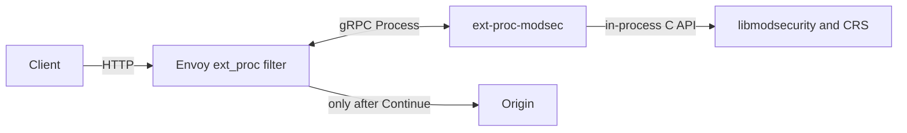
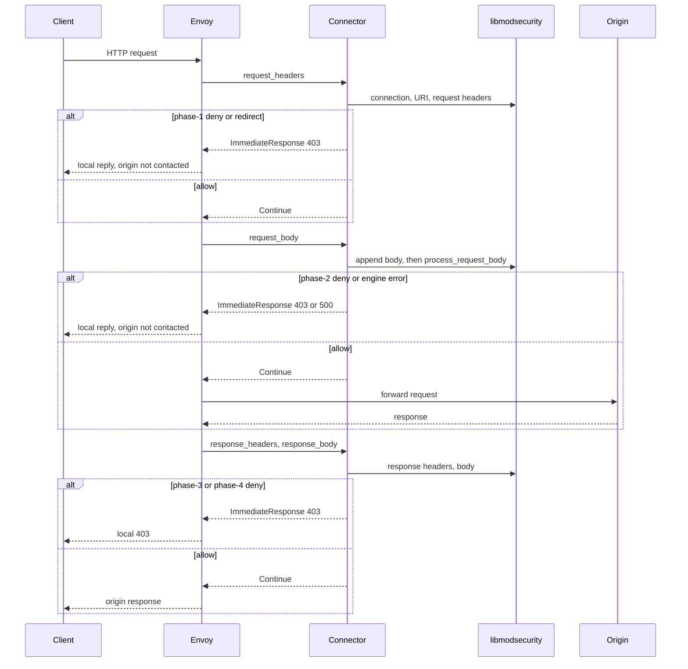

# How it works

Where the connector sits, how one HTTP exchange moves through it, and what the client sees. Failure handling: [fail-closed.md](./fail-closed.md). Body modes: [body-modes.md](./body-modes.md). What Envoy forwards to ModSec (and how to aim SecRules): [crs-and-envoy-limits.md](./crs-and-envoy-limits.md). Running it: [getting-started.md](./getting-started.md), [deploy.md](./deploy.md).

## What this is

Envoy cannot run ModSecurity itself. `ext-proc-modsec` is a small Rust gRPC server that Envoy's External Processing (`ext_proc`) filter calls for every HTTP exchange. It loads libmodsecurity in-process, feeds the request headers, request body, response headers and response body into **one ModSecurity transaction**, and answers each step with:

- **Continue**: Envoy may go on, and only then contacts the origin on the request path;
- a rule-driven **local reply**, typically **403**, or a redirect;
- a fail-closed **500** when the engine cannot produce a trustworthy decision.

The connector never connects to your origin. Only Envoy does, and only after Continue.

## Where it sits

| Hop | From → to | Protocol | Reaches the origin? |
|-----|-----------|----------|---------------------|
| 1 | client → Envoy | HTTP/1.1, HTTP/2 | no |
| 2 | Envoy ↔ connector | gRPC, `envoy.service.ext_proc.v3.ExternalProcessor/Process` | no (side call) |
| – | connector → libmodsecurity | in-process C API (`msc_*`) | no |
| 3 | Envoy → origin | HTTP | **yes, Envoy only**, after Continue |

Settings that must not be relaxed on a protecting filter:

- `failure_mode_allow: false`: connector down or stream error → Envoy local **500**;
- `message_timeout` (demo: 2 s): connector hung → Envoy local **504**. Envoy does not apply it under FULL_DUPLEX_STREAMED;
- never `observability_mode`: Envoy does not wait for the answers.

## Request path

One gRPC `Process` stream is one HTTP request and response, and one ModSecurity transaction. The diagram shows BUFFERED, the default; [body-modes.md](./body-modes.md) shows what changes in the other modes.

HTTP/1.1 and HTTP/2 take the same path. Envoy joins split HTTP/2 `Cookie` headers before the connector sees them. `allow_custom_methods` in the Envoy config lets CRS rule 911100 judge non-standard methods instead of Envoy's codec dropping them. `demo/scripts/hop-trace.sh` follows one request across Envoy, the connector and the origin by `x-request-id`.

## One exchange, step by step

| Envoy sends | Connector does | Answers |
|-------------|----------------|---------|
| `request_headers` | Reads `protocol_config` (first message only) and opens the transaction (id generated by the connector; `x-request-id` is logged next to it). Runs `process_connection` (client/server IP:port from Envoy attributes), `process_uri`, adds non-pseudo headers as the raw bytes Envoy forwards (`host` from `:authority` if missing), `process_request_headers`. If `end_of_stream` or the request body mode is NONE, also runs the request-body phase. | Continue, or terminal reply |
| `request_body` | `append_request_body` (intervention checked on every append); when the body phase ends ([body-modes.md](./body-modes.md#where-the-body-phase-ends)) runs `process_request_body` (CRS phase 2). | Continue, or terminal reply |
| `response_headers` | If the request body phase has not run, fails closed (**500**) for a status below 400, and inspects the request body late for 4xx/5xx. Adds headers, `process_response_headers` (phase 3). If `end_of_stream` or the response body mode is NONE, also runs the response-body phase. | Continue, or terminal reply |
| `response_body` | `append_response_body`; when the body phase ends runs `process_response_body` (phase 4). | Continue, or terminal reply |
| trailers | Trailer *values* are not CRS-inspected (no SecLang trailer phase). Trailers end a STREAMED / FULL_DUPLEX body phase that is still open (BUFFERED bodies already ended at their one message), then Continue. Without a session → fail-closed **500**. | Continue, body deny **403**, or **500** |
| `response_headers` with **no** prior `request_headers` | Envoy rejected the request itself before the request phase (e.g. `#fragment` → 400) and ext_proc only sees that local reply. Origin was never contacted. 4xx/5xx pass through; anything else fails closed. | Continue (4xx/5xx), else **500** |

Stream end drops the session, which runs ModSecurity's logging phase (audit log) and frees the transaction. That drop runs on Tokio's blocking pool, after any terminal reply has been handed to tonic, so audit-log I/O neither stalls an async worker nor delays a **403**. Out-of-order or malformed messages fail closed with **500**.

The stream only ends with gRPC **OK** after a terminal `ImmediateResponse`, or when Envoy closes its side with every message answered. Envoy v1.39 treats an OK close as "processing complete" and forwards whatever it holds, so every other end is a non-OK gRPC status, which `failure_mode_allow: false` turns into a local **500**: a message the connector cannot read (including one larger than `--max-grpc-message-bytes`), Envoy closing while a FULL_DUPLEX body is still held or a body phase is still open, a ModSecurity drop (`ABORTED`), or a connector panic (h2 stream reset).

## What the client sees

| Result | Connector answer | Client sees | Where to look |
|--------|------------------|-------------|---------------|
| no disruptive intervention | Continue | the origin's response | phase log `action=allow` |
| deny with a 4xx or 5xx status | `ImmediateResponse` with that status and a generic body | e.g. **403** `Forbidden` | Envoy `%RESPONSE_CODE_DETAILS%` = `modsecurity_intervention`; rule detail in the connector log and the ModSecurity audit log |
| deny with any other status | `ImmediateResponse` **403** (Envoy v1.39 would otherwise send an invalid status as **200**) | **403** | as above |
| redirect | `ImmediateResponse` 3xx with `Location` (302 if the rule's status is not 3xx) | **302** | `action=redirect` |
| drop (intervention status 0) | gRPC stream aborted | Envoy local **500** | deny metric |
| engine or protocol failure, a missing or unsupported `protocol_config`, response headers (status below 400) before the request body phase ran, a FULL_DUPLEX body above `--max-held-body-bytes` | `ImmediateResponse` **500**, details `modsec_fail_closed` | **500** | `action=fail_closed` |
| a message larger than `--max-grpc-message-bytes`, or otherwise unreadable | gRPC stream ended with `INTERNAL` | Envoy local **500** | connector log `read error`; `ext_proc_stream_errors_total` |
| Envoy silent past `--stream-idle-timeout` before the verdict, or a FULL_DUPLEX stream past `--duplex-idle-timeout` / `--duplex-total-timeout` | `ImmediateResponse` **504**, details `modsec_stream_timeout` | **504** | `%RESPONSE_CODE_DETAILS%` |
| `CONNECT` | the recommended Envoy config answers it with a direct **403** and ext_proc disabled; if one reaches the connector anyway, `ImmediateResponse` **403**, details `connect_rejected` | **403** | Envoy access log |
| connector down | no answer | Envoy **500** | `ext_proc_error_*`; `failure_mode_allowed` must stay 0 |
| connector hung | no answer in time | Envoy **504** (none under FULL_DUPLEX_STREAMED) | `message_timeouts` |

The deny body is always generic. Rule ids and matched data go only to the connector log and the audit log, never to the client. After any terminal answer the connector closes the stream.

## What is not inspected

| Surface | What happens |
|---------|--------------|
| gRPC message bodies | headers, path and metadata are inspected (`hop-trace-grpc.sh`); protobuf bodies are not. Fail-closed still holds |
| WebSocket frames | the upgrade handshake can be inspected with a headers-only route; frames after the upgrade are not. BUFFERED on an upgrade route hangs |
| HTTP/3 | lab demo suite only (`demo/scripts/h3-probe.sh` + `demo/envoy/envoy-h3.yaml`); not a product body mode, not PR CI, not a CRS H3 claim |
| trailer values | never inspected; trailers only end a STREAMED / FULL_DUPLEX body phase. Configs with a body mode need trailer mode `SEND`; `SKIP` lets the request reach origin |
| bodies under NONE, and past the limit under BUFFERED_PARTIAL | [body-modes.md](./body-modes.md) |
| Non-URI `Referer`, hop-by-hop `Connection` | Envoy may remove them before `ext_proc`, so rules that only look at those values may not fire. Absolute-URI Referers still reach ModSec. [crs-and-envoy-limits.md](./crs-and-envoy-limits.md) |
| Envoy's own local replies before the request phase | passed through, not inspected; the origin was never contacted |
| pause interventions | logged and ignored: ext_proc has no delay primitive |

What Envoy forwards to ModSec (Referer, Connection, body modes, FTW harness): [crs-and-envoy-limits.md](./crs-and-envoy-limits.md). Configuration, health checks and metrics: [deploy.md](./deploy.md).
