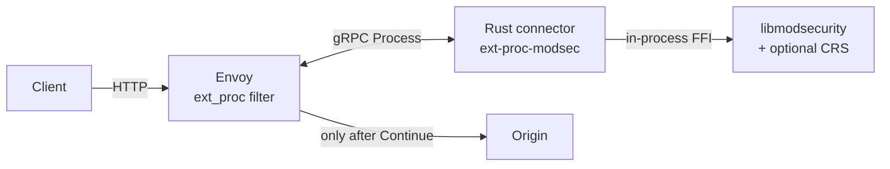
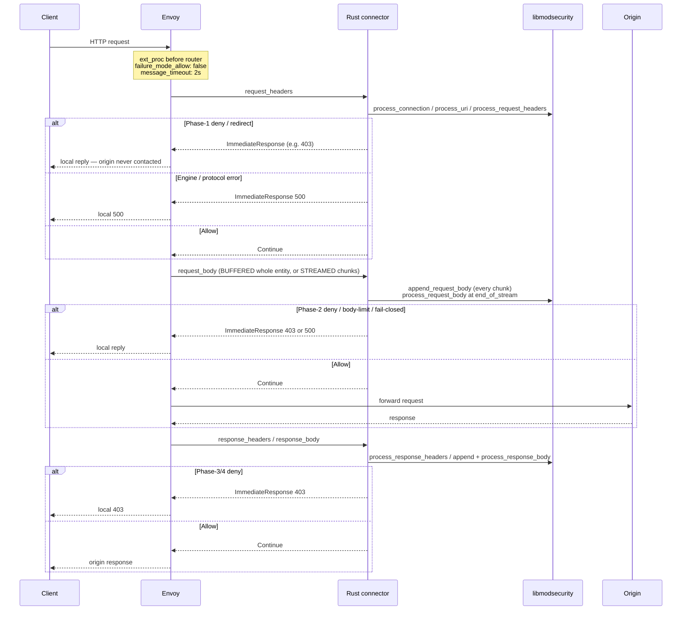
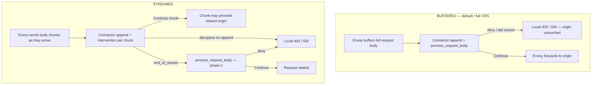

# How it works

This page is the cold-reader brief: what the product is, where it sits, how an HTTP request moves through it, and what you see when something is blocked or the WAF cannot decide.

Pins: [`versions.lock.md`](../versions.lock.md). Failure model: [fail-closed.md](./fail-closed.md). Tests: [testing.md](./testing.md). Local PoC (build → exercise → tear down): [README Getting Started](../README.md#getting-started-local-poc). Deeper demo notes: [`demo/README.md`](../demo/README.md).

---

## What this is

**envoy-modsec-connex** protects HTTP workloads that sit behind [Envoy Proxy](https://www.envoyproxy.io/) with **ModSecurity** and (optionally) the **OWASP Core Rule Set (CRS)**.

Envoy cannot run ModSecurity itself. This project is a small Rust gRPC server (`ext-proc-modsec`) that Envoy's **External Processing** (`ext_proc`) filter calls for every HTTP exchange. The connector feeds request headers, request body, response headers, and response body into **one libmodsecurity transaction** and answers each step with:

- **Continue** — Envoy may proceed (and only then may contact the origin on the request path),
- a rule-driven **local reply** (typically **403**, or a redirect), or
- a fail-closed **500** when the engine cannot produce a trustworthy decision.

The connector never dials your origin. Only Envoy does, and only after Continue.

---

## Where it sits

Three network hops, plus one in-process call:

| Hop | From → To | Protocol | Reaches origin? |
|-----|-----------|----------|-----------------|
| 1 | Client → **Envoy** | HTTP/1.1, HTTP/2 | No |
| 2 | **Envoy ↔ connector** | gRPC bidi `envoy.service.ext_proc.v3.ExternalProcessor/Process` | No — side-call |
| — | connector → **libmodsecurity** | in-process FFI (`msc_*` C API in `modsec-engine`) | No |
| 3 | **Envoy → origin** | HTTP | **Yes — Envoy only**, after Continue |

Demo ports (local): Envoy `:18080`, connector `:18081`, metrics/healthz `:18082`, origin `:18098`.

Enforcement settings that must not be relaxed on a protecting filter:

- `failure_mode_allow: false` — connector down or stream error → Envoy local **500**
- `message_timeout: 2s` — connector hung → Envoy local **504**
- Never enable `observability_mode` for enforcement — Envoy does not wait for answers there

---

## Request path

One `Process` stream = one HTTP request/response = **one ModSecurity transaction**.

HTTP/1.1 and HTTP/2 (cleartext prior knowledge in the demo) use the same connector path. Envoy reassembles split HTTP/2 `Cookie` headers before the connector sees them. The demo enables `allow_custom_methods` so CRS rule 911100 enforces method policy instead of the codec dropping non-standard methods.

`demo/scripts/hop-trace.sh` walks one request across Envoy, the connector, and the origin by `x-request-id`.

---

## Body modes that change the path

The connector code path is the same for both modes: **append every chunk, check intervention on every append, run `process_*_body` at `end_of_stream`**. What changes is when Envoy is willing to forward bytes toward the origin.

| Mode | Envoy behaviour | Origin exposure on request deny | Demo / CI |
|------|-----------------|----------------------------------|-----------|
| **BUFFERED** (default) | Holds the full request (and response) entity until the connector has inspected it | A request-body deny happens **before** the origin sees anything — including when the attack sits only in the last chunk or last HTTP/2 DATA frames | `demo/envoy/envoy.yaml`; full CRS / go-ftw |
| **STREAMED** | Delivers body chunks as they arrive | Non-disruptive Continues may let early chunks move toward the origin before phase-2/4 decides at EOS; body-limit rejects can still fire mid-stream on append | `demo/envoy/envoy-streamed.yaml`, `BODY_MODE=STREAMED ./demo/scripts/up.sh`; thin smoke + fail-closed |

Envoy's buffer limit (default 1 MiB per stream) caps BUFFERED inspectable body size; STREAMED moves buffering into the connector/engine. Full go-ftw stays on BUFFERED. Phase-2/4 CRS rules still decide at EOS in both modes.

---

## One exchange, step by step

| Envoy sends | Connector does | Answers |
|-------------|----------------|---------|
| `request_headers` | Opens the transaction (id = `x-request-id`). Runs `process_connection` (client/server IP:port from Envoy attributes), `process_uri`, adds non-pseudo headers (`host` from `:authority` if missing), `process_request_headers`. If `end_of_stream`, also runs the request-body phase. | Continue, or terminal reply |
| `request_body` | `append_request_body` (intervention checked on every append); at `end_of_stream` runs `process_request_body` (CRS phase 2). | Continue, or terminal reply |
| `response_headers` | Closes an unfinished request body if needed, adds headers, `process_response_headers` (phase 3). If `end_of_stream`, also runs the response-body phase. | Continue, or terminal reply |
| `response_body` | `append_response_body`; at `end_of_stream` runs `process_response_body` (phase 4). | Continue, or terminal reply |
| trailers | Trailer *values* are not CRS-inspected (no SecLang trailer phase). Default demo keeps trailer modes `SKIP`. With `SEND`, unfinished body is finalized when trailers mark EOS, then Continue. Without a session → fail-closed **500**. | Continue, body deny **403**, or **500** |
| `response_headers` with **no** prior `request_headers` | Envoy rejected the request itself before the request phase (e.g. `#fragment` → 400) and ext_proc only sees that local reply. Origin was never contacted. 4xx/5xx pass through; anything else fails closed. | Continue (4xx/5xx), else **500** |

Stream end drops the session, which runs ModSecurity's logging phase (audit log) and frees the transaction. Out-of-order or malformed messages fail closed with **500**.

---

## Fail-closed (path-level)

**Deny ≠ fail.** A rule deny (**403**) means the WAF decided. **500** / **504** means it could not decide — and traffic must not reach the origin as OK.

| Case | Who enforces | Client |
|------|--------------|--------|
| Connector not running / crashed / stream error | Envoy (`failure_mode_allow: false`) | **500** |
| Connector hung past `message_timeout` (2s) | Envoy | **504** |
| Rules fail to load at boot | Connector exits non-zero before binding; Envoy then returns 500 | **500** |
| Per-request engine error / phase-order / malformed message | Connector `ImmediateResponse` 500 (`modsec_fail_closed`) | **500** |
| Rule deny | Connector `ImmediateResponse` (rule status, validated) | typically **403** |

There is **no** code path that answers Continue after an engine error. Body mode (BUFFERED / STREAMED) does not relax fail-closed. Details and drills: [fail-closed.md](./fail-closed.md).

---

## What is not inspected

These bounds are intentional and proven by demo suites — do not read them as temporary gaps to paper over in a README.

| Surface | What happens | Bound |
|---------|--------------|-------|
| **gRPC protobuf bodies** | Headers / path / metadata hop-trace works (`hop-trace-grpc.sh`, `envoy-grpc.yaml` with body `NONE`). Fail-closed holds. | **Not** protobuf CRS / streaming RPC WAF. Stock CRS may still deny HTTP-shaped paths on the gRPC codec; that is not “gRPC body CRS.” |
| **WebSocket frames** | Handshake can be ModSec-inspected with headers-only + upgrade config. Post-upgrade frames are opaque (SQLi-shaped frames echo). | **Not** frame CRS. BUFFERED+upgrade can hang; fail-closed still applies on the handshake path. |
| **HTTP/3** | No QUIC listener in the product demo. | Not supported. |
| **Trailer values** | No SecLang trailer phase. | Not CRS-inspected; product default is `SKIP`. |
| **Envoy local replies before request phase** | Connector only sees the local reply stream. | Not ModSec-inspected; 4xx/5xx pass through. |
| **Pause interventions** | Logged and ignored. | ext_proc has no delay primitive. |
| **Drop → TCP reset** | Maps to gRPC stream abort → Envoy **500**. | ImmediateResponse cannot close the TCP connection. |

---

## What you see when blocked

| Engine / path result | Connector answer | Client sees | Ops signal |
|----------------------|------------------|-------------|------------|
| No disruptive intervention | Continue | Origin response | phase log `action=allow` |
| Deny with status 4xx/5xx | `ImmediateResponse` with that status, generic body | e.g. **403** `Forbidden` | Envoy `%RESPONSE_CODE_DETAILS%` = `modsecurity_intervention`; connector log + ModSecurity audit log hold rule detail |
| Deny with any other status (1–399, ≥ 600, or unknown to Envoy) | `ImmediateResponse` **403** | **403** | same — statuses are validated because Envoy v1.39 would otherwise send an invalid ImmediateResponse as **HTTP 200** |
| Redirect | `ImmediateResponse` 3xx (302 if the rule's status is not 3xx) + `Location` | **302** | `action=redirect` |
| Drop (intervention status 0) | Stream aborted with gRPC `ABORTED` | Envoy local **500** | deny metric; not status 0 |
| Engine / protocol failure | `ImmediateResponse` **500**, details `modsec_fail_closed` | **500** | `action=fail_closed` |
| `CONNECT` | `ImmediateResponse` **403**, details `connect_rejected` | **403** | CONNECT never reaches a BUFFERED body hang |
| Connector down | *(no answer)* | Envoy **500** | `ext_proc_error_*`; `failure_mode_allowed` must stay **0** |
| Connector hung | *(no answer in time)* | Envoy **504** | `message_timeouts` |

The deny body is always generic (`Forbidden`). Rule ids and matched data go only to the connector log and the ModSecurity audit log — never to the client. After any terminal answer the connector closes the stream.

---

## Code map

| Crate / file | Role |
|--------------|------|
| `crates/modsec-engine/` | The only crate with `unsafe`. Declares the libmodsecurity v3 `msc_*` API; `Engine` loads rules at boot; `InspectionSession` is one transaction and maps interventions to `Decision`. |
| `crates/ext-proc-modsec/src/processor.rs` | `ModSecProcessor` (tonic). One `Exchange` per gRPC stream; turns each `ProcessingRequest` into Continue / terminal reply / abort. |
| `crates/ext-proc-modsec/src/responses.rs` | Builds Continue / `ImmediateResponse`; validates statuses. |
| `crates/ext-proc-modsec/src/connection_meta.rs` | Reads Envoy `request_attributes` for `process_connection` / URI protocol. |
| `crates/ext-proc-modsec/src/metrics.rs`, `metrics_server.rs` | Prometheus counters/histograms; `GET /metrics`, `GET /healthz`. |
| `crates/ext-proc-modsec/src/pb/` | Committed prost/tonic for `envoy.service.ext_proc.v3` (Envoy v1.39.1 API closure). |

---

## Configuration

Connector flags (each also readable from the environment):

| Flag | Env | Default | Notes |
|------|-----|---------|-------|
| `--listen` | `EXT_PROC_LISTEN` | `127.0.0.1:18081` | gRPC address Envoy's `modsec_ext_proc` cluster targets (HTTP/2). |
| `--metrics-listen` | `EXT_PROC_METRICS_LISTEN` | `127.0.0.1:18082` | `/metrics` and `/healthz`. |
| `--modsec-rules` | `MODSEC_RULES` | *(required)* | One or more files, loaded in order (engine directives → `crs-setup.conf` → `rules/*.conf`). |

Logging: `RUST_LOG` (default `info`); ModSecurity's own messages are under target `modsecurity` at `debug`.

Envoy settings the connector relies on (see [`demo/envoy/envoy.yaml`](../demo/envoy/envoy.yaml)):

- `failure_mode_allow: false` and `message_timeout: 2s`
- `processing_mode`: headers `SEND`, bodies `BUFFERED` (default) or `STREAMED`, trailers `SKIP` (product default)
- `request_attributes`: `source.address`, `source.port`, `destination.address`, `destination.port`, `request.protocol` — without them ModSecurity sees `127.0.0.1` as `REMOTE_ADDR`
- `http_protocol_options.allow_custom_methods: true` so CRS sees methods like `TEST`

---

## Observability

- **Logs** (`tracing`): one line per phase with `request_id`, `phase`, `action` (`allow` / `deny` / `redirect` / `drop` / `fail_closed`), `latency_ms`, `body_bytes`.
- **Metrics** (`GET /metrics`): `ext_proc_requests_total`, `ext_proc_allow_total`, `ext_proc_deny_total`, `ext_proc_fail_closed_total`, `ext_proc_stream_errors_total`, `ext_proc_local_reply_passthrough_total`, body-byte counters, and per-phase latency histograms.
- **Readiness** (`GET /healthz`): 200 only if, within 2s, the gRPC listener completes an HTTP/2 preface + SETTINGS exchange **and** a headers-only probe through a fresh in-process `Exchange` answers Continue.
- **Envoy side**: `%RESPONSE_CODE_DETAILS%` shows `modsecurity_intervention` / `modsec_fail_closed` / `ext_proc_error_*`; watch `http.<prefix>.ext_proc.modsec_ext_proc.*` (`streams_failed`, `message_timeouts`, `failure_mode_allowed` must stay 0).
