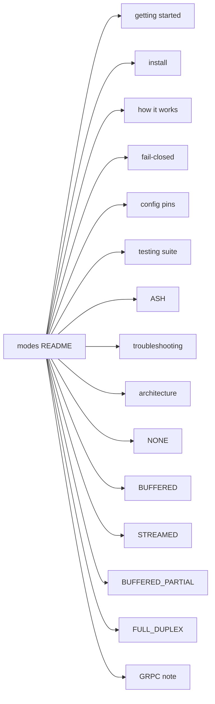

# envoy-modsec-connex docs

Local PoC, install/build, product path, testing map, and every Envoy `BodySendMode` Connex ships (plus GRPC unimplemented). Mermaid renders on GitHub and in the Docsify Pages shell.

Pins: Envoy **v1.39.2**, libmodsecurity **v3.0.17**, CRS **v4.30.0**.

## Start here

| Page | Topic |
|------|--------|
| [Getting started](./getting-started.md) | Clone, pin-safe install, `up.sh`, smoke, what “working” looks like |
| [Install / build](./install.md) | Prerequisites, connector build, demo knobs, release image, Envoy wiring |
| [How it works](./how-it-works.md) | Request path and what is / isn’t inspected (thin; links the full repo doc) |
| [Fail-closed](./fail-closed.md) | 403 vs 500/504; who owns each class |
| [Config / pins](./config-pins.md) | Version pins, `BODY_MODE`, demo YAMLs, how to pick a mode |
| [Testing suite](./testing-suite.md) | smoke / fail-closed / go-ftw / e2e / `crs-full` (matrix wired vs proven) |
| [Security scan (ASH)](./ash.md) | Report-only CI scan and how to run it locally |
| [Troubleshooting](./troubleshooting.md) | 403 vs 503; CRS block vs fail-closed |
| [Architecture](./architecture.md) | Envoy HCM → ext_proc → Rust filter → libmodsecurity + CRS |

## Body modes

| Page | Mode |
|------|------|
| [NONE](./none.md) | No bodies to the processor |
| [BUFFERED](./buffered.md) | Full entity, then one body message (product default) |
| [STREAMED](./streamed.md) | Chunks as they arrive |
| [BUFFERED_PARTIAL](./buffered-partial.md) | Prefix / soft-limit class |
| [FULL_DUPLEX_STREAMED](./full-duplex-streamed.md) | Duplex stream + `StreamedBodyResponse` |
| [GRPC](./grpc.md) | Enum value **unimplemented** on pinned Envoy v1.39.2 |

## Mode comparison

| Mode | What Envoy does | Request body deny vs origin | CRS response (phase 3/4) | CRS coverage | Demo YAML | CI |
|------|-----------------|----------------------------|---------------------------|--------------|-----------|-----|
| **NONE** | Headers only; bodies never sent | Body attacks **reach** origin | Headers yes; **body no** | Body CRS **n/a** | `envoy-none.yaml` | `e2e-none` |
| **BUFFERED** | Buffer full body; one `HttpBody` at EOS | Deny **before** origin | **Yes** (demo sends response bodies) | Smoke + hosted **full** (proven) | `envoy.yaml` | `e2e-pin` + `crs-full` |
| **STREAMED** | Chunks as seen; reply per chunk | Early chunks may move before EOS phase-2 | **Yes** | Smoke hosted; full matrix **wired** | `envoy-streamed.yaml` | `e2e-streamed`; `crs-full` wired |
| **BUFFERED_PARTIAL** | Buffer up to soft limit; over-limit may skip body | Under-limit like BUFFERED; trailing over-limit can miss | **Yes** when body messages arrive | **Under-limit only** | `envoy-buffered-partial.yaml` | `e2e-buffered-partial` |
| **FULL_DUPLEX_STREAMED** | Duplex stream; trailers **SEND**; `message_timeout` **off** | Connector holds until allow (`--body-reply streamed`); deny keeps origin +0 | **Yes** | Smoke hosted; full matrix **wired** | `envoy-full-duplex.yaml` | `e2e-full-duplex`; `crs-full` wired |
| **GRPC** | Not implemented on pinned Envoy v1.39.2 | n/a | n/a | Out of scope | n/a | n/a |

Sources: [How it works](./how-it-works.md), [Testing suite](./testing-suite.md). Full repo docs: [how-it-works](https://github.com/etiennemunnich/envoy-modsec-connex/blob/main/docs/how-it-works.md), [testing](https://github.com/etiennemunnich/envoy-modsec-connex/blob/main/docs/testing.md).

## Enable this site on GitHub

**Browse on GitHub (Mermaid works in GFM):** open any `.md` file under `docs/modes/`.

**GitHub Pages (Docsify + Mermaid):**

1. Repo **Settings → Pages**
2. Source: **Deploy from a branch**
3. Branch: `main` (after merge), folder: **`/docs`**
4. Site entry: `…/modes/` (serves `docs/modes/index.html`)

**GitHub Wiki (optional):** copy these pages into the wiki remote; GFM Mermaid renders there too. This tree is the in-repo canonical copy so PRs and Pages stay reviewable. See [PUBLISHING.md](./PUBLISHING.md).

