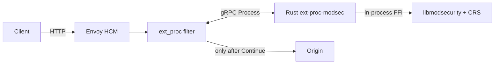
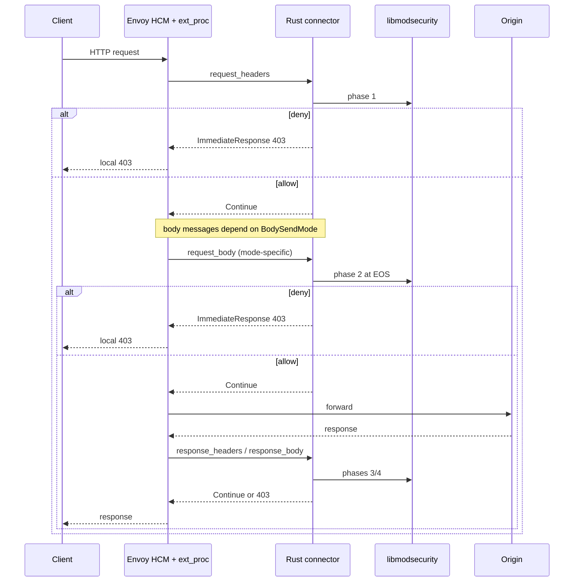

# Architecture

How an HTTP exchange reaches ModSecurity under envoy-modsec-connex.

## Pieces

| Piece | Role |
|-------|------|
| **Envoy HCM** | Accepts the client HTTP/1.1 or HTTP/2 request. Runs the filter chain before the router. |
| **ext_proc filter** | Side-calls the connector over gRPC (`ExternalProcessor/Process`). Holds or streams bodies per `BodySendMode`. |
| **Rust connector** (`ext-proc-modsec`) | One gRPC stream = one ModSecurity transaction. Never dials the origin. |
| **libmodsecurity** | In-process via the connector’s C API (`msc_*`). Optional **OWASP CRS** rules loaded at boot. |
| **Origin** | Only Envoy contacts it, and only after **Continue**. |

Demo ports: Envoy `:18080`, connector gRPC `:18081`, metrics/healthz `:18082`, origin `:18098`.

## ModSecurity phases on the wire

| Envoy message | Connector action | ModSec phase |
|---------------|------------------|--------------|
| `request_headers` | open transaction; connection/URI/headers | **1** |
| `request_body` | append; `process_request_body` at EOS | **2** |
| `response_headers` | response headers | **3** |
| `response_body` | append; `process_response_body` at EOS | **4** |
| stream end | logging / free transaction | **5** |

Body modes change **whether and when** Envoy sends body messages, not the connector’s append / EOS phase logic. Product demos set the same mode on request and response bodies unless a lab YAML says otherwise.

## Enforcement knobs (all product demos)

| Knob | Product value | Effect |
|------|---------------|--------|
| `failure_mode_allow` | `false` | Connector down / stream error → Envoy **500** |
| `message_timeout` | `2s` (demo) | Stall past timeout → **504**. Under `FULL_DUPLEX_STREAMED` (and `GRPC` if implemented), Envoy turns this timer off, so the usual stall→504 check does not apply |
| Header modes | `SEND` | Phase 1 / 3 always available when headers are sent |
| Trailer modes | `SKIP` default; **SEND** required for duplex | Trailer *values* are not CRS-inspected |
| `--body-reply` | `common` default; `streamed` for duplex | Wire shape of Continue on body messages |

Deeper Pages entry: [How it works](./how-it-works.md). Fail-closed: [Fail-closed](./fail-closed.md). Full repo docs: [how-it-works](https://github.com/etiennemunnich/envoy-modsec-connex/blob/main/docs/how-it-works.md), [fail-closed](https://github.com/etiennemunnich/envoy-modsec-connex/blob/main/docs/fail-closed.md).
