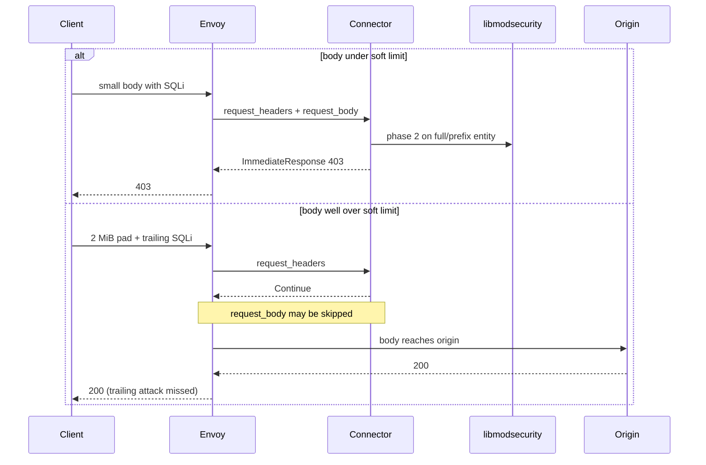
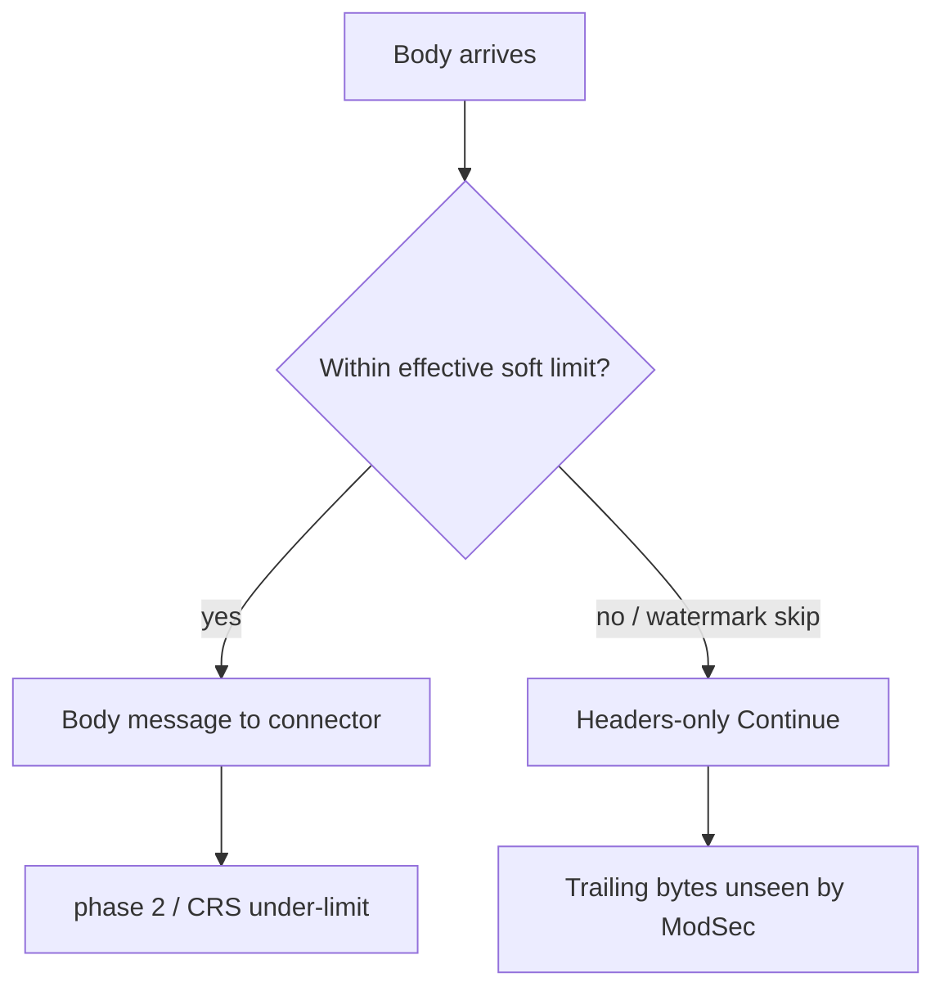

# BUFFERED_PARTIAL

Prefix / soft-limit class. Same honesty family as ModSecurity `SecRequestBodyLimitAction ProcessPartial`.

## What Envoy does

Buffer up to the configured limit and send a body message (full entity if under limit, prefix-class behaviour when over). With a 1 MiB soft `per_connection_buffer_limit_bytes`, bodies just over 1 MiB may still fully reach the connector; roughly **2 MiB+** can skip `request_body` (headers-only Continue). That shape was observed on Envoy v1.39.1. The runtime pin is now v1.39.3; this page does not claim a fresh measurement. Not a hard 413 like BUFFERED.

## Flow with this filter + ModSecurity / CRS

Under the soft limit, behaviour matches BUFFERED for typical CRS body sizes. Over the effective cut, trailing attacks can miss phase-2.

| Phase | Runs? | Notes |
|-------|-------|-------|
| 1 | **Yes** | |
| 2 | **Sometimes** | Runs when a body message arrives; missing over-limit body → no full phase-2 on the trailing bytes |
| 3 | **Yes** | Headers |
| 4 | **Sometimes** | Same soft-limit class on `response_body_mode: BUFFERED_PARTIAL` |

## CRS response inspection (phase 3/4)

Phase 3 runs on response headers. Phase 4 runs only when a response body message is delivered (same soft-limit caveats as the request side). **Do not** treat PARTIAL as full response-body CRS fidelity.

## Config knobs

| Knob | Value |
|------|-------|
| Demo YAML | [`demo/envoy/envoy-buffered-partial.yaml`](../../demo/envoy/envoy-buffered-partial.yaml) |
| Soft limit | `per_connection_buffer_limit_bytes: 1048576` (1 MiB) |
| Selector | `BODY_MODE=BUFFERED_PARTIAL` |
| `--body-reply` | `common` |
| `message_timeout` | `2s` |
| Honesty drill | `demo/scripts/partial-honesty.sh` (in-prefix 403; 2 MiB trailing → 200) |

## When to use

Use when you explicitly want ProcessPartial-style inspection and will document the miss window.

Never claim full go-ftw / BUFFERED parity. CI refuses `go-ftw-full` under this mode. Hosted cell `e2e-buffered-partial` = smoke + fail-closed + go-ftw-smoke + honesty only.

**Coverage:** under-limit smoke/body CRS only; 2 MiB trailing bypass proven.
