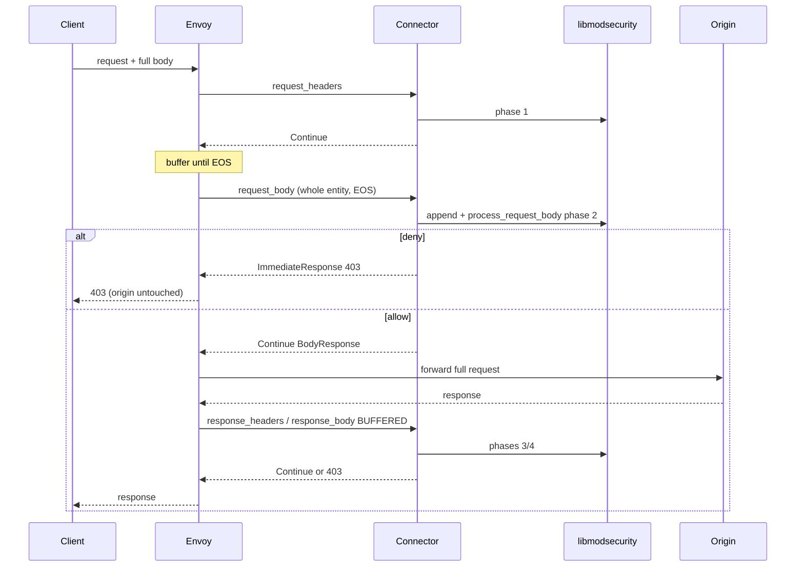
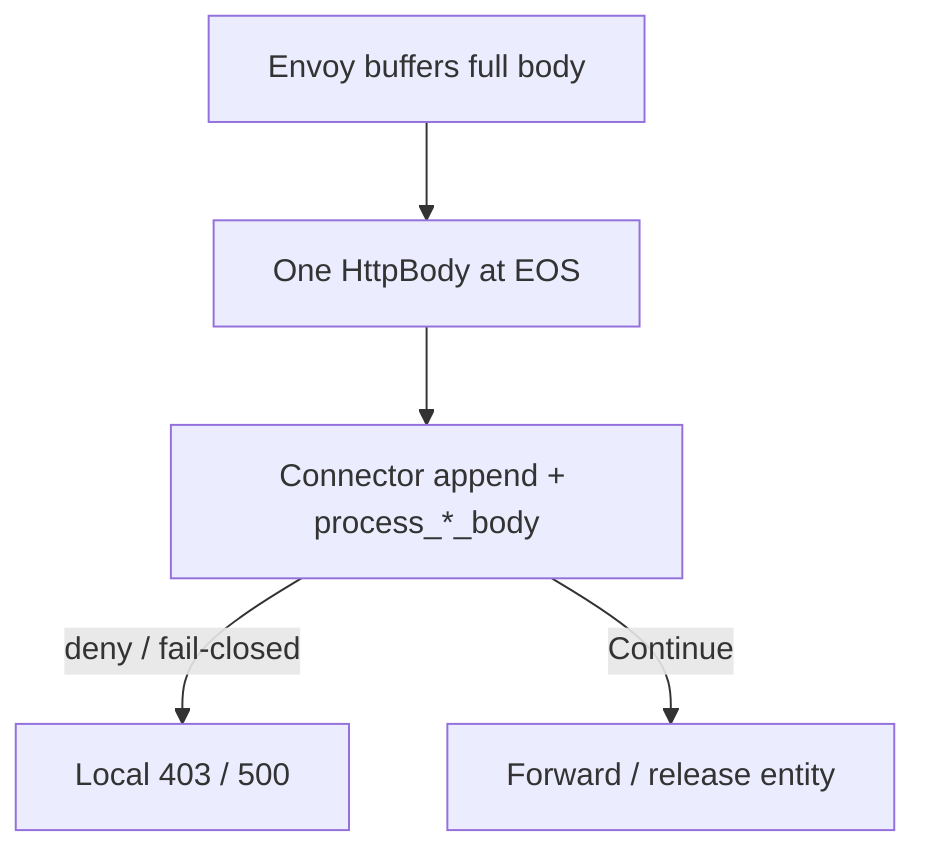

# BUFFERED

Product default. Envoy holds the full body, then sends one body message at end-of-stream.

## What Envoy does

Buffer the complete request (and, in the product demo, response) entity. Deliver a single `HttpBody` with `end_of_stream` when the entity is complete. Over the hard buffer path, oversize typically becomes a downstream error (demo oversize drill → 413-class behaviour).

## Flow with this filter + ModSecurity / CRS

Closest match to ModSec “complete entity, then decide.”

| Phase | Runs? | Notes |
|-------|-------|-------|
| 1 | **Yes** | Headers before body |
| 2 | **Yes** | Full body; `process_request_body` at EOS |
| 3 | **Yes** | Response headers |
| 4 | **Yes** | Full response body (demo `response_body_mode: BUFFERED`) |

A request-body deny lands **before** the origin sees anything, including attacks only in the last HTTP/1.1 chunk or last HTTP/2 DATA frames.

## CRS response inspection (phase 3/4)

**Yes.** Product `envoy.yaml` sets `response_body_mode: BUFFERED`. Smoke includes response leak → 403. Full go-ftw (local tip **5091/0**, hosted `crs-full`) exercises the CRS suite under this mode.

## Config knobs

| Knob | Value |
|------|-------|
| Demo YAML | [`demo/envoy/envoy.yaml`](../../demo/envoy/envoy.yaml) (+ `envoy-trailers.yaml`, `envoy-buffered-oversize.yaml`) |
| Selector | default / `BODY_MODE=BUFFERED` |
| `--body-reply` | `common` → empty `BodyResponse` Continue |
| `message_timeout` | `2s` (stall past timeout → Envoy **504**) |
| Trailers | product `SKIP`; SEND optional labs |
| Buffer limits | Envoy stream / connection buffer caps inspectable size |

## When to use

Use when you want request-body deny before origin and a full CRS claim. Lowest open body-correctness risk among modes for a single-filter HTTP WAF path.

Cost: whole-body RAM; opaque buffer limits; HTTP/1.1 upgrade + BUFFERED can hang waiting for body EOS ([envoy#47081](https://github.com/envoyproxy/envoy/issues/47081)). Product scopes WebSocket off this body mode for frames.

**Coverage:** smoke + hosted full CRS (proven). Hosted product cell `e2e-pin`; monthly/dispatch `crs-full` × BUFFERED.
