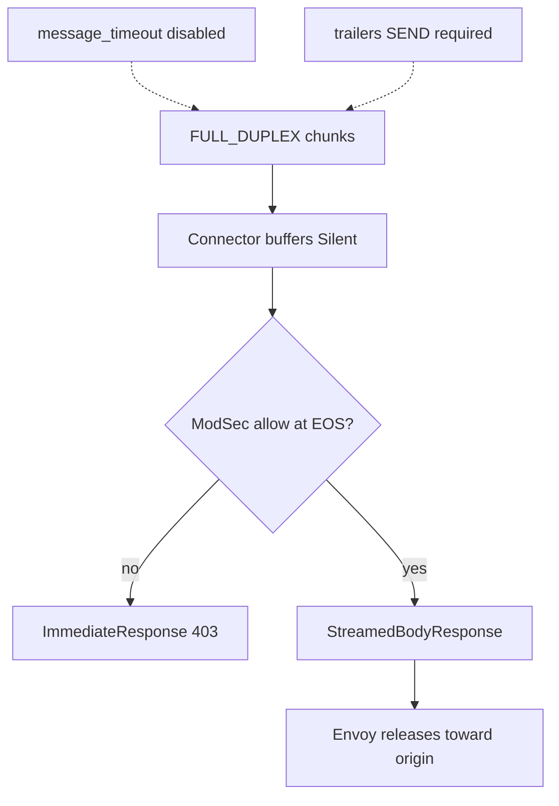

# FULL_DUPLEX_STREAMED

Duplex streamed bodies. Continue must use `StreamedBodyResponse`. Trailers must be `SEND`. Envoy disables `message_timeout`.

## What Envoy does

Full-duplex streamed body path. The processor must answer body messages with `BodyMutation.streamed_response` (`StreamedBodyResponse`), not a normal empty `BodyResponse`. Trailer mode **SEND** is required. Per-message timeout is **off** for this mode (Envoy docs: no timeout for `FULL_DUPLEX_STREAMED` / `GRPC`).

## Flow with this filter + ModSecurity / CRS

Connex sets `--body-reply streamed` automatically for this mode. The connector **buffers chunks (Silent)** and only emits `StreamedBodyResponse` after ModSec allows, so request-body deny still keeps the origin at +0 (unlike naive STREAMED early Continues).

| Phase | Runs? | Notes |
|-------|-------|-------|
| 1 | **Yes** | |
| 2 | **Yes** | After reassembly; deny before streamed release |
| 3 | **Yes** | Response headers |
| 4 | **Yes** | Demo sets `response_body_mode: FULL_DUPLEX_STREAMED` |

Client trailers may be folded into body EOS by Envoy; you may not see a separate `RequestTrailers` message.

```mermaid
sequenceDiagram
  participant C as Client
  participant E as Envoy
  participant R as Connector
  participant M as libmodsecurity
  participant U as Origin

  C->>E: duplex body stream
  E->>R: request_headers
  R-->>E: Continue
  E->>R: request_body chunks FULL_DUPLEX
  Note over R: buffer Silent; no StreamedBodyResponse yet
  R->>M: append; process_request_body at EOS
  alt deny
    R-->>E: ImmediateResponse 403
    E-->>C: 403 (origin +0)
  else allow
    R-->>E: StreamedBodyResponse Continue
    E->>U: forward
    U-->>E: response stream
    E->>R: response_body FULL_DUPLEX
    R->>M: phases 3/4
    R-->>E: StreamedBodyResponse or 403
    E-->>C: response
  end
```



## CRS response inspection (phase 3/4)

**Yes.** Phase 3 and phase 4 both run (same as BUFFERED / STREAMED). Product duplex YAML sends response bodies in `FULL_DUPLEX_STREAMED`. **Local** evidence (not hosted `crs-full`):

- Smoke includes response leak → 403
- Local go-ftw smoke/body/full under duplex: **8+118 / 118 / 5091** (matches BUFFERED local parity). Those counts were taken on CRS v4.29.0. The pin is now **v4.30.0**; this page does not restate them as a v4.30.0 run. Hosted `crs-full` × FULL_DUPLEX is matrix-wired, not yet proven green on tip.

## Config knobs

| Knob | Value |
|------|-------|
| Demo YAML | [`demo/envoy/envoy-full-duplex.yaml`](../../demo/envoy/envoy-full-duplex.yaml) |
| Selector | `BODY_MODE=FULL_DUPLEX_STREAMED` |
| `--body-reply` | **`streamed`** (required; `common` → Envoy `spurious_message`) |
| `message_timeout` | Present in YAML for parity; **off** for duplex streaming (the usual stall→504 timeout check does not apply) |
| Trailers | **SEND** request + response |
| Open Envoy risks | duplicate EOS [#46237](https://github.com/envoyproxy/envoy/issues/46237), upgrade hang [#47161](https://github.com/envoyproxy/envoy/issues/47161), high memory [#39514](https://github.com/envoyproxy/envoy/issues/39514) |

## When to use

Use when you need the duplex wire protocol and still want request-body deny before origin (Connex Silent buffer helps). Full CRS is locally proven.

Costs: open upstream duplex lifecycle bugs; historically higher RAM reports. `message_timeout` is off for duplex streaming, so the usual stall→504 timeout check does not apply.

**Coverage:** Hosted `e2e-full-duplex` product suites; **local** go-ftw full **5091/0**. `crs-full` × FULL_DUPLEX is **matrix-wired**; hosted green on tip is not yet shown.
