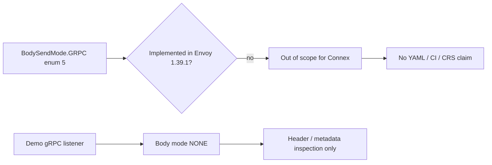

# GRPC (`BodySendMode` enum 5): unimplemented

This is **not** “gRPC routes in the demo.” It is Envoy’s `BodySendMode.GRPC` value on the ext_proc processing-mode enum.

## Status on Envoy v1.39.1

Marked `[#not-implemented-hide:]` in the pin proto. Envoy does not implement this send mode yet.

| Surface | Connex policy |
|---------|----------------|
| Demo YAML | **None** |
| `BODY_MODE=` | **None** |
| CI cell | **None** |
| CRS claim | **None** (out of scope) |

If it were implemented, Envoy would also disable `message_timeout` (same class as `FULL_DUPLEX_STREAMED`) and would expect `StreamedBodyResponse`-style Continues.

## Not the same as demo gRPC

| Topic | What Connex ships |
|-------|-------------------|
| gRPC **routes** / protobuf bodies | Headers-only path (`envoy-grpc.yaml`, body `NONE`). Not protobuf CRS. |
| `BodySendMode.GRPC` | Unimplemented upstream (document only) |

See [NONE](./none.md) for the headers-only body mode that protocol demos actually use.
