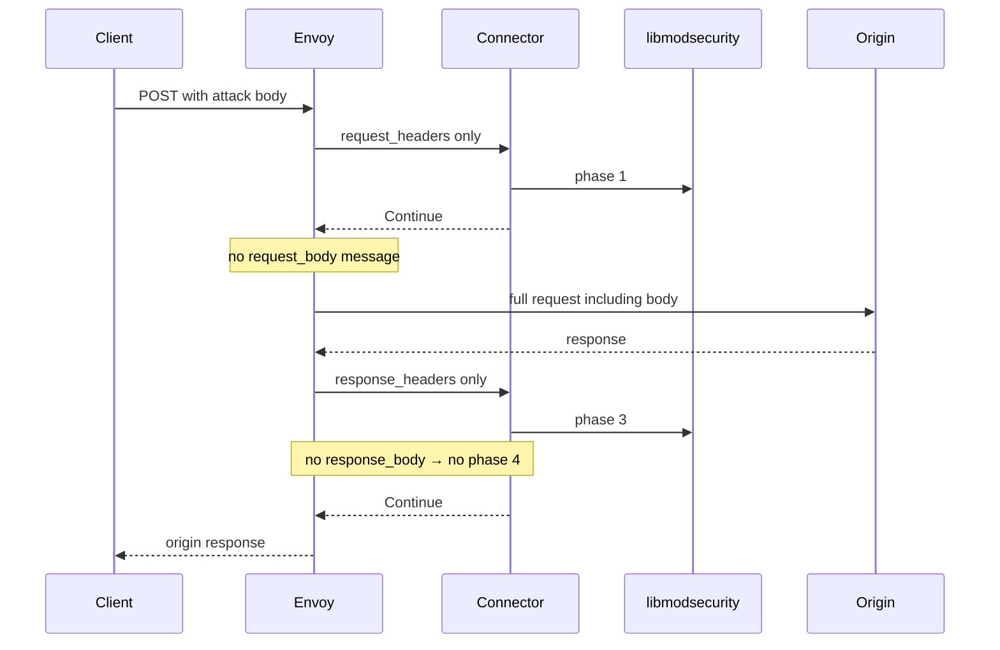

# NONE

Envoy’s default `BodySendMode`. Bodies never go to ext_proc.

## What Envoy does

`request_body_mode` / `response_body_mode` = `NONE`. Envoy still sends request and response **headers** (product demos use `SEND`). No `HttpBody` messages for that direction.

## Flow with this filter + ModSecurity / CRS

| Phase | Runs? | Notes |
|-------|-------|-------|
| 1 request headers | **Yes** | Query / header CRS can still fire |
| 2 request body | **No** | No body bytes to append or process |
| 3 response headers | **Yes** | Header-only response rules can fire |
| 4 response body | **No** | Response body CRS does **not** run |

Body attacks must reach the origin. Smoke under `BODY_MODE=NONE` asserts that bypass.

## CRS response inspection (phase 3/4)

| | |
|--|--|
| Phase 3 | **Yes** (response headers sent) |
| Phase 4 | **No** (`response_body_mode: NONE`) |

Do not claim response-body CRS (e.g. leak-style body rules) under NONE.

## Config knobs

| Knob | Value |
|------|-------|
| Demo YAML | [`demo/envoy/envoy-none.yaml`](../../demo/envoy/envoy-none.yaml) |
| Selector | `BODY_MODE=NONE ./demo/scripts/up.sh` |
| `--body-reply` | unused for bodies (no body Continues) |
| `message_timeout` | `2s` (applies to **header** messages) |
| Trailers | `SKIP` |
| Related | `envoy-grpc.yaml`, `envoy-ws-headers.yaml` (headers-only protocol demos) |

## When to use

Use when you only need header/query WAF on a route (gRPC metadata path, upgrade handshake, explicit body bypass lab).

Do not use when you need body CRS or response-body rules. Never run go-ftw body/full under NONE; that would pretend body inspection exists.

**Coverage (tip `537532f`):** body CRS **n/a**; `e2e-none` gates headers smoke + fail-closed + connect-assert.
