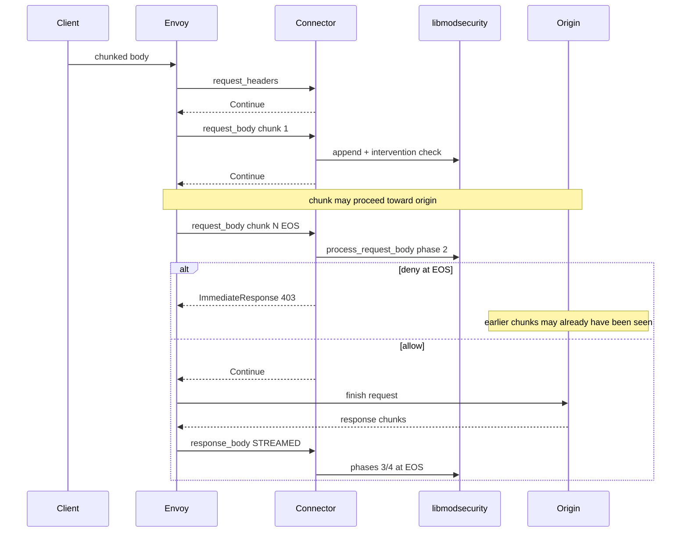
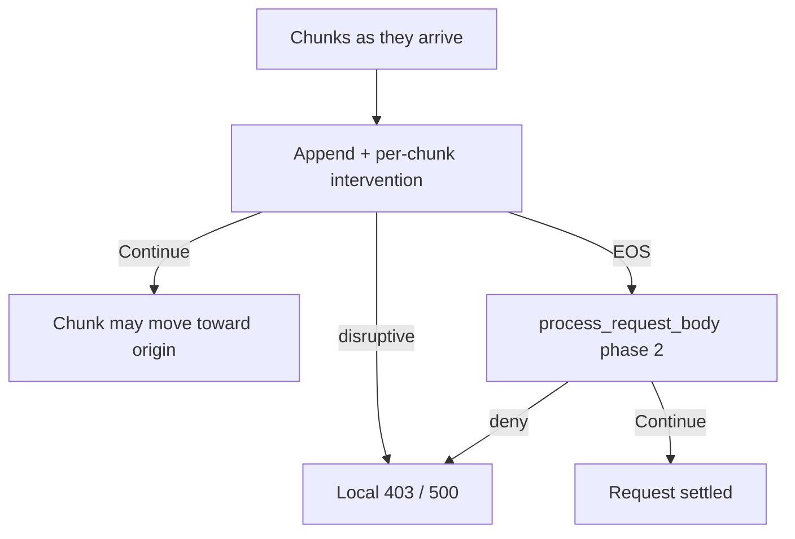

# STREAMED

Envoy sends body chunks as they arrive. The connector still reassembles for ModSec phase-2/4 at end-of-stream.

## What Envoy does

Deliver each body chunk to ext_proc when seen. The processor replies per chunk. Not the whole-body 413 path of BUFFERED; watermarks apply instead. Content-Length is stripped by default unless `allow_content_length_header` is set.

## Flow with this filter + ModSecurity / CRS

Connector path matches BUFFERED: **append every chunk**, check intervention on append, run `process_*_body` at EOS. What changes is Envoy’s willingness to let early chunks move toward the origin after non-disruptive Continues, before phase-2 decides at EOS.

| Phase | Runs? | Notes |
|-------|-------|-------|
| 1 | **Yes** | |
| 2 | **Yes** | At EOS after reassembly; mid-stream deny possible on append intervention |
| 3 | **Yes** | |
| 4 | **Yes** | Demo `response_body_mode: STREAMED` |

## CRS response inspection (phase 3/4)

**Yes** when response bodies are streamed to the connector (product streamed YAML). Phase-4 still decides at response EOS after reassembly.

## Config knobs

| Knob | Value |
|------|-------|
| Demo YAML | [`demo/envoy/envoy-streamed.yaml`](../../demo/envoy/envoy-streamed.yaml) (+ `envoy-streamed-trailers.yaml`) |
| Selector | `BODY_MODE=STREAMED` |
| `--body-reply` | `common` |
| `message_timeout` | `2s` per message (stall past timeout → Envoy **504**) |
| Trailers | `SKIP` product; SEND in trailers safety YAML |
| Asymmetric labs | `envoy-req-streamed-resp-buffered.yaml` / reverse (secondary axes) |

## When to use

Use when you need lower whole-body buffering at Envoy and accept that benign Continues can expose early request chunks before EOS phase-2.

Risks: higher message count; open dual-filter + trailer issues ([envoy#47449](https://github.com/envoyproxy/envoy/issues/47449)); STREAMED + WebSocket hang reported against Envoy 1.39.1 ([envoy#47048](https://github.com/envoyproxy/envoy/issues/47048)). The runtime pin is v1.39.4; this page does not claim that hang was re-measured on the pin.

**Coverage:** Hosted `e2e-streamed` product suites (smoke / fail-closed / go-ftw-smoke). Local tip go-ftw full **5091/0**. `crs-full` × STREAMED is **matrix-wired**; hosted go-ftw-full green on tip is not yet shown.
