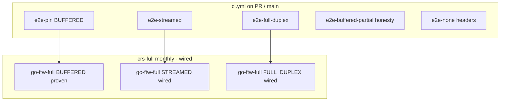

# Testing suite

Map of local scripts and hosted CI cells: what each command runs, what it proves, and which body modes get product coverage vs full-CRS wiring.

Authoritative detail and measured minutes: [docs/testing.md](https://github.com/etiennemunnich/envoy-modsec-connex/blob/main/docs/testing.md) (repo). Demo script table: [`demo/README.md`](../../demo/README.md).

Pins: Envoy **v1.39.1**, libmodsecurity **v3.0.17**, CRS **v4.29.0**.

## Local commands

Bring the demo up first (`./demo/scripts/up.sh`, or `BODY_MODE=… ./demo/scripts/up.sh`).

| Command | Proves |
|---------|--------|
| `./demo/scripts/smoke.sh` | Benign **200**; URL + body denies **403**; response-body **403**; CONNECT **403**; origin untouched on deny. Body-path floor ≥ 5 (NONE: header floor + body-bypass honesty). |
| `./demo/scripts/fail-closed.sh` | Connector kill → **500**; bad rules → **500**; stall past `message_timeout` → **504** (skipped under `FULL_DUPLEX_STREAMED`, where Envoy turns that timer off). Origin untouched during failures. |
| `./demo/scripts/fail-modes.sh` | Fail-closed classes 1-6 over HTTP/1.1 **and** HTTP/2; cookie split; last-chunk attack; negative control with temporary `failure_mode_allow: true`. Stall→504 cells skipped under FULL_DUPLEX. |
| `./demo/scripts/go-ftw.sh smoke` | Demo tests + body-heavy CRS SQLi/XSS (HTTP/1.x, status codes). Needs go-ftw (`install-go-ftw.sh`). |
| `./demo/scripts/go-ftw.sh body` | Broader body-focused CRS selection. |
| `./demo/scripts/go-ftw.sh full` | Whole CRS regression tree. Also the suite behind monthly `crs-full`. |
| `./demo/scripts/partial-honesty.sh` | **BUFFERED_PARTIAL only:** in-prefix SQLi **403**; trailing over-limit SQLi may miss (**200**); not a full-CRS claim. |
| `./demo/scripts/hop-trace.sh` | One request across hops by `x-request-id`. |
| `./demo/scripts/trailers.sh` | Trailer `SEND` safety (floor ≥ 5). Trailer *values* not CRS-inspected. |
| `cargo test --workspace` | Rust unit + gRPC tests against libmodsecurity (incl. class-3 fail-closed paths). |

Tear down: `./demo/scripts/down.sh`. Artifacts land under `demo/.run/`.

## Hosted CI cells

Workflows: [`.github/workflows/ci.yml`](../../.github/workflows/ci.yml), [`live-e2e.yml`](../../.github/workflows/live-e2e.yml), [`crs-full.yml`](../../.github/workflows/crs-full.yml). Live suites run on `main` pushes, PRs, and dispatches (× `ubuntu-24.04` + `ubuntu-24.04-arm`). Docs-only PRs skip the heavy jobs.

| Job / workflow | `BODY_MODE` | Suites (summary) |
|----------------|-------------|------------------|
| `e2e-pin` | **BUFFERED** | smoke, fail-closed, fail-modes, hop-trace, go-ftw-smoke, buffered-oversize, connect-assert, trailers |
| `e2e-streamed` | **STREAMED** | smoke, fail-closed, fail-modes, hop-trace, go-ftw-smoke, trailers, connect-assert |
| `e2e-full-duplex` | **FULL_DUPLEX_STREAMED** | same product set as streamed (`message_timeout` off → stall→504 cell skipped) |
| `e2e-buffered-partial` | **BUFFERED_PARTIAL** | smoke, fail-closed, go-ftw-smoke, partial-honesty, connect-assert; **not** full CRS fidelity |
| `e2e-none` | **NONE** | smoke, fail-closed, connect-assert; body CRS **n/a** |
| `e2e-asymm-*` | asymmetric req/resp | smoke, fail-closed, go-ftw-smoke, connect-assert |
| `crs-full` (monthly / dispatch) | **BUFFERED**, **STREAMED**, **FULL_DUPLEX_STREAMED** × both arches | `go-ftw-full` only; matrix **wired**; see coverage table |

Reusable cell: `live-e2e.yml` → `./scripts/ci-live-e2e.sh` with `SUITES=…` and `BODY_MODE=…`.

## Body-mode coverage

| Mode | Product suites (smoke / fail-closed / …) | go-ftw smoke | go-ftw **full** (`crs-full`) | Notes |
|------|------------------------------------------|--------------|------------------------------|-------|
| **BUFFERED** | Hosted (`e2e-pin`) | Hosted | Hosted; **proven green** | Product default |
| **STREAMED** | Hosted (`e2e-streamed`) | Hosted | Matrix **wired**; tip hosted green **not yet shown** | Local full **5091/0**; phase-2/4 still decide at EOS |
| **FULL_DUPLEX_STREAMED** | Hosted (`e2e-full-duplex`) | Hosted | Matrix **wired**; tip hosted green **not yet shown** | Local full **5091/0**; connector holds until allow |
| **BUFFERED_PARTIAL** | Honesty cell | Under-limit only | **No**; excluded from `crs-full` | Soft-limit miss is expected |
| **NONE** | Headers + fail-closed | Body suites **n/a** | **No** | Body attacks reach origin |
| **GRPC** BodySendMode | n/a | n/a | n/a | Unimplemented on Envoy 1.39.1 |

## Limits

- **go-ftw is HTTP/1.x**, status-code judged. HTTP/2 evidence is `fail-modes.sh --proto h2`.
- **PARTIAL** and **NONE** are never full-CRS claims.
- Stall→504 depends on Envoy `message_timeout`. Under FULL_DUPLEX that timeout is off; see [Fail-closed](./fail-closed.md) and [FULL_DUPLEX](./full-duplex-streamed.md), not the CRS tables.
- WebSocket frames and gRPC protobuf bodies are not CRS-inspected (handshake / headers hop-traces exist separately).

Per-mode pages: [NONE](./none.md) · [BUFFERED](./buffered.md) · [STREAMED](./streamed.md) · [BUFFERED_PARTIAL](./buffered-partial.md) · [FULL_DUPLEX_STREAMED](./full-duplex-streamed.md).
